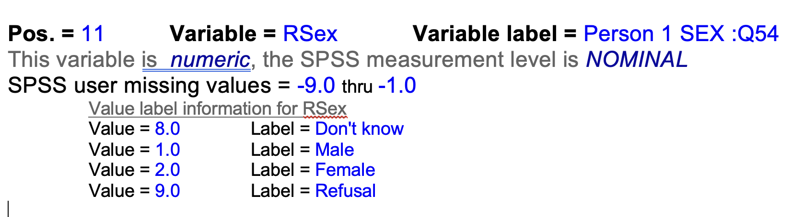

## Introduction

In unit 3 we get to grips with the basics of data wrangling, manipulation or cleaning. This involves the execution of a series of tasks and the application of techniques with the goal of preparing your data for analysis so it's in the right shape for your research goals.

We will be using continuous and categorical data from the **British Social Attitudes (BSA)** survey to explore a number of real life scenarios in which you may find yourself when preparing data for analysis. In going through these you will learn:

1.  how to subset a dataset
2.  how to define missing values for a variable;
3.  how to recode a categorical variable into another categorical variable;
4.  how to recode a continuous variable into categorical variable;
5.  how to combine two categorical variables
6.  how to recode multiple variables at a time NEW!

Before getting started, it is worth emphasising that, in any given project, you should expect data wrangling to constitute the main bulk of the work. This is because it involves:

1.  quite a lot of coding,
2.  regular checks and revisions,
3.  thinking about research design

The latter point is crucial. While the practical aspects of subsetting or recoding may feel like data engineering problems, **the choices you make must be consistent with your substantive research goals and questions**. This means you need to think quite hard about issues such as measurement (e.g. should age be treated continuosly or categorically?) or the target population (e.g. should the sample include employees only or also the self-employed). These are primarily substantive and research design issues, not merely computing or statistical problems, so remember **to keep your sociological, criminological, etc hat on at all times.**

As always, we begin by loading the BSA dataset and the tidyverse libraries, only one of which is strictly speaking not necessary to do any of the recoding work.

Note that today we will be using a new function to load the data. Instead of `load()` we will use `read_dta()` from the `haven` package which allows us to **import** datasets

```{r, message=FALSE}
library(haven)
library(tidyverse)
library(labelled)

bsa <- read_dta("bsa13ukds.dta")
```

## Scenario 1: Subsetting a dataset

In this first scenario we will subset a dataset to contain only certain types of observations defined according to one or more criteria. We will have a look at three examples: (a) subsetting on a continuous variable, (b) subsetting on a categorical variable; and (c) subsetting on two variables.

The general syntax to subset is `newdata <- data[condition ,]` where `newdata` is the subset dataset, `data` stands for the original dataset and `condition` is the criterion or criteria by which you want to select cases - any case that meets that condition will be included in the new dataset.

Conditions are specified within square brackets and involve a variable name, a logical operator and a value, **followed by a comma** (don't forget the comma!). The logical operators are:

- equal to **==**
- different from **!=**
- smaller/less than **\<**
- greater/more than **\>**
- smaller/less than or equal to **\<=**
- greater/more than or equal to **\>=**

To specify multiple conditions we use so-called Boolean operators:

- `&` which stands for AND - this is to specify that the selected cases must meet both conditions, e.g. being female AND being in favour of more redistribution
- **`|`** which stands for OR - this is to specify that the selected cases must meet at least one of the condition (and includes those who meet both) - e.g. being female or being in favour of more redistribution

If you prefer the `tidyverse` approach you may want to use the following functions or verbs:

- `filter()` is similar to the `[,]` in that it will return those cases that meet the condition specified between brackets and exclude the rest

- `between()` will return those cases that are between the first and second values for a particular variable

Both base `R` and `tidyverse` approaches will be demonstrated.

### Subsetting on a continuous variable: Selecting respondents 18-25

Suppose you want to conduct research on the social attitudes of young people and that you, as the researcher, **define** young people to be those who are between 18 and 25 years old. This **decision** you have made then needs to be translated into the analysis such that:

- those who are between 18 and 25 are included

- those who are younger than 18 or older than 25 are excluded

To do so, you need to ask R to subset those respondents that have a value in the BSA variable measuring age - called `RAge` for respondent age - **equal or greater than 18** AND **equal or smaller than 25**.

Let's first look at the distribution of `Rage`:

```{r}
table(bsa$RAge)
```

From this respondents we are only interested in the following:

```{r}
#| echo: false
bsa1825 <- bsa[bsa$RAge >= 18 & bsa$RAge <= 25,]

# check you got the new data correctly
table(bsa1825$RAge)
```

In R this is achieved as follows:

```{r}
# subset the data based on the specified condition
bsa1825<-bsa[bsa$RAge >= 18 & bsa$RAge <= 25,]
# check you got the new data correctly
table(bsa1825$RAge)
```

You can achieve the same using the function `filter` from `dplyr`

```{r}
# then subset the data according to the specified condition
bsa1825a <- bsa |> 
  filter(RAge>=18 & RAge<=25)

# check you got the new data correctly
table(bsa1825a$RAge)

```

Or again using `filter` AND `between` from `dplyr`

```{r}
# then subset the data according to the specified condition
bsa1825b <- bsa |> 
  filter(between(RAge, 18, 25))

# check you got the new data correctly
table(bsa1825b$RAge)
```

### Subsetting on a categorical or factor variable: Selecting female respondents only

Suppose you want to conduct an analysis on **female respondents only**. To do this you will need a dataset that includes those respondents who replied "Female" to the question "Sex" and exclude those respondents who replied "Male" from the original dataset.

There are basically two variants of this scenario: a) the categories are represented as numbers with their corresponding labels; and b) the categories are represented as text.

#### Categories as numerical values with labels

The function `read_dta()`, which we have used earlier to import the Stata data file, makes some decisions to how the data will be organised. In particular, it treats categorical variables in a similar way to how Stata and SPSS, among others, by using **values** and **labels.**

Note that the values are part of your data while the labels are part of the file's **metadata** - e.g. data about the data. These metadata contain all sorts of information (value labels, variable labels, dates, times, etc.) that we will not analyse as such but which we need to be aware of when working with datasets.

Let's look at the variable Rsex looks like:

```{r}
# first check the distribution of sex categories
table(bsa$RSex)
```

As you can see there are only numbers `1` and `2`, but what do these numbers mean? One option is to look at the [codebook](https://doc.ukdataservice.ac.uk/doc/7500/mrdoc/allissue/bsa13ukds_ukda_data_dictionary.rtf) to figure out the labels:



The other is to use the function `val_labels()` from the `labelled` package:

```{r}
val_labels(bsa$RSex)
```

Now that we know that value 1 indicates "Male" respondents and value 2 indicates "Female" respondents we can proceed to subset the data:

```{r}

# then subset the data according to the specified condition
bsafem <- bsa[bsa$RSex == 2,]
# check you got the new data correctly
table(bsafem$RSex)
```

You can achieve the same using the function **filter** from *dplyr*

```{r}

# then subset the data according to the specified condition
bsafem <- bsa |> 
  filter(RSex == 2)

# check you got the new data correctly
table(bsafem$RSex)
```

#### Categories as text

In some datasets, categorical variables will appear as factors or a string variables. In such situations, the categories will appear as text rather than as numerical values. To show this we will create a new variable called `sexf` that will contain the same observations as `RSex` but is forced to become a factor variable:

```{r}
bsa$sexf <- as_factor(bsa$RSex)
table(bsa$sexf)
```

Since "Male" and "Female" are now the categories we need to adapt our code accordingly.

```{r}
# then subset the data according to the specified condition
bsafem <- bsa[bsa$sexf=="Female",]
# check you got the new data correctly
table(bsafem$sexf)
```

You can achieve the same using the function **filter** from *dplyr*

```{r}

# then subset the data according to the specified condition
bsafem <- bsa |> 
  filter(sexf=="Female")

# check you got the new data correctly
table(bsafem$sexf)
```

### Subsetting on multiple variables: Selecting young females

Suppose you want to conduct analysis only on young female respondents - respondents that are young AND female. All you need to do is to specify both conditions simultaneously:

```{r}
# subset the data according to the specified condition
bsafem1825<-bsa[bsa$RAge >= 18 & bsa$RAge <= 25 & bsa$RSex== 2,]
# check you got the new data correctly
table(bsafem1825$RSex)
table(bsafem1825$RAge)
```

Or using **filter** we can achieve the same result

```{r}
# subset the data according to the specified condition
bsafem1825b <-
  bsa |> 
  filter(between(RAge, 18, 25) & RSex == 2)

# check you got the new data correctly
table(bsafem1825b$RSex)
table(bsafem1825b$RAge)
```

There will be more complex scenarios that may involve very long chains of subsetting conditions. To handle those, you may prefer to recode variables first to ease the process. You will find out whether you need more complex code as you decide on your assignment project.

### Subsetting on multiple non-consecutive values of the same categorical variable:

Suppose you want to conduct analysis only with some specific educational categories in your sample, for instance only those cases that are either A-level, Degree or GCSE holders. This is straightforward to do using base R by just subsetting on three conditions (A-level OR Degree) as follows

```{r}
bsa_edu_sel <- bsa[bsa$HEdQual == 3 | 
                     bsa$HEdQual == 1 | 
                     bsa$HEdQual == 4,] 

table(bsa_edu_sel$HEdQual)
```

If you want to follow tidyverse syntax you can simplify things by using the expression **`%in%`** inside of the filter function as follows:

```{r}
bsa_edu_sel2 <- bsa |> 
  filter(bsa$HEdQual %in% c(1, 3, 4))  
table(bsa_edu_sel2$HEdQual)
```

What this will do is to match all cases that have a response in variable HEdQual that is equal to EITHER of the three categories specified in the code.

> Make sure that you are using the right values, or you risk ending up with the wrong subsample.

## Scenario II: Recoding a categorical variable

In this second scenario you may come across when preparing your data, we will recode or recategorise a categorical variable. In this case we will recode variable education because it has too many categories (too much detail) that we do not need in our analysis. There are two main ways in which we can recode this variable and end up with the same result. Below you will get an explanation of both.

Before we start recoding this variable, check out the codebook or data dictionary. Here is what it says about our variable:

```         
Value label information for HEdQual
Value = 1.0 Label = Degree
Value = 2.0 Label = Higher educ below degree
Value = 3.0 Label = A level or equiv
Value = 4.0 Label = O level or equiv
Value = 5.0 Label = CSE or equiv
Value = 6.0 Label = Foreign or other
Value = 7.0 Label = No qualification
Value = 8.0 Label = DK/Refusal/NA
```

Next step is to look at how the variable is distributed to get a sense of how many respodents fall into each category. Since we are dealing with a categorical variable we can use the function `table()` to get a frequency table:

```{r}
table(bsa$HEdQual)
```

Knowing in advance the distribution of the variable (i.e. the raw counts or frequencies for each category) will be useful to check that the recoding worked as you intended. In this case we will recode categories of "HEdQual" to a new variable called "educ4" as follows - in brackets you'll find the number of respondents you should expect in each new category:

1.  Category "Degree" as is ($n_{degree}$ = 714)
2.  Categories "Higher educ below degree" and "A level or equiv" as "Higher Secondary Education" ($n_{highsec}$ = 328 + 496 = 824)
3.  Categories "CSE or equiv", "Foreign or other" and "O level or equiv" as "Lower Secondary Education" ($n_{lowsec}$= 544 + 171 + 36 = 751)
4.  Category "No qualification" as is ($n_{noqual}$ = 690)
5.  Category "DK/Refusal/NA" as missing values (NA = 265)

If by the end of the recoding you have got these frequencies then you've done things correctly. Otherwise, check your code!

### Base R

We will start by creating a new variable with missing values for all observations:

```{r}
# assign missing values (NA) to new variable educ4 in dataset bsa
bsa$educ4 <- NA
```

The next step is to assign values to the new variable based on the categories in the old variable. Notice that the condition is specified in brackets and that to represent the "OR" operator we use the pipe symbol or vertical bar "\|". Thus \[eyes==blue \| hair==blond\] would be specifying all those individuals who have blue eyes OR who have blond hair (which notice also includes those who have both), but would not include those who have neither blue eyes nor blond hair. Notice how we use two equal signs "==" to specify the condition "equal to".

```{r}

# Assign value 1 to new variable "educ4" in dataset bsa to all those respondents that answered "Degree" to old variable "HEdQual"
bsa$educ4[bsa$HEdQual == 1] <- 1

# Assign value 2 to new variable "educ4" in dataset bsa to all those respondents that answered "Higher educ below degree" OR "A level or equiv" in old variable "HEdQual"
bsa$educ4[bsa$HEdQual == 2 |
            bsa$HEdQual == 3
            ] <- 2
# Assign value 3 to new variable "educ4" in dataset bsa to all those respondents that answered "CSE or equiv" OR "Foreign or other" OR "O level or equiv" in old variable "HEdQual"
bsa$educ4[bsa$HEdQual == 4 |
            bsa$HEdQual == 5 |
            bsa$HEdQual == 6 
          ] <- 3
# Assign value 4 to new variable "educ4" in dataset bsa to all those respondents that answered "No qualification" to old variable "HEdQual"
bsa$educ4[bsa$HEdQual == 7
          ] <- 4
```

Once recoded, there are a couple of steps we need to perform to make sure that R treats the new variable as a categorical variable or factor (R name for categorical variables). This includes defining the levels of a variable - i.e. what the values 1, 2, 3, 4 actually mean in terms of educational attainment.

```{r}
# first we define variable educ4 as a factor variable with the function as.factor()
bsa$educ4 <- as.factor(bsa$educ4)

# then we define the variable levels. Make sure you get the order right so that the values you defined earlier (1, 2, 3, 4) correspond to the levels 
levels(bsa$educ4) <- c("Degree", 
                       "Higher secondary", 
                       "Lower secondary", 
                       "No qualification")

```

Finally, check you did the recoding correctly by first, running a frequency table of the new variable; and secondly, run a contingency table of the old and the new variable to check that the respondents have been recategorised exactly as you wanted.

```{r}
#check recoding with a frequency table
table(bsa$educ4)

#check recoding with a contingency table to check the correspondence between old and new 
#categories
table(bsa$HEdQual, bsa$educ4) 
```

### Tidyverse approach: Using **mutate** and **case_when**:

```{r}
bsa <- 
  bsa |>
  mutate(
    educ4t = case_when(
      HEdQual == 1 ~ 1,  
      HEdQual %in% c(2, 3) ~ 2,  
      HEdQual %in% c(4, 5, 6) ~ 3, 
      HEdQual == 7 ~ 4, 
      TRUE ~ NA_real_
    ))

bsa$educ4t <- as.factor(bsa$educ4)
levels(bsa$educ4t) <- c("Degree",
                       "Upper Sec. Educ",
                       "Lower Sec. Educ",
                       "No qual")
table(bsa$educ4t)
```

## Scenario III: Recoding a continuous variable (numeric) into a categorical variable (factor)

Next we will turn a continuous variable into a categorical variable. We will use a typical example in survey analysis: recoding a continuous variable "RAge" into a categorical variable made up of age bands, which we will call "age4cat". Again, the principles applied earlier will be of use. A key difference is that we will use the ampersand sign **&** to indicate that two conditions must occur simultaneously. Thus \[eyes==blue **&** hair==blond\] would be specifying all those individuals who have BOTH blue eyes AND who have blond hair. Typically, this will be used to identify observations that are larger or equal (\>=) AND smaller or equal (\<=) than the extremes in a range of values - e.g. people who are taller or equal to 1.70m (height\>=1.70) and shorter or equal to 1.80m (heigh\<=1.80).

To break down the variable "RAge" we use the following code. Notice how many of the steps used here applied to the earlier example.

The first step would be to look at the codebook or data dictionary:

```         
SPSS user missing values = -9.0 thru -1.0
Value label information for RAge
Value = 97.0    Label = 97 or more
Value = 98.0    Label = Don't know
Value = 99.0    Label = Refusal
```

Next, let us explore the original variable:

```{r}
#check the variable is continuous... it is!
is.numeric(bsa$RAge)

#check the values of the original continuous variable 
#(possible because of the range of values is short):
table(bsa$RAge)

#if dealing with a variable with a larger range of values use the describe() function

bsa |> 
  drop_na(RAge) |> 
  summarise(mean = mean(RAge),
            min = min(RAge),
            max = max(RAge))

```

Notice the 5 respondents with values 99 in RAge! These people are not 99 years old, but were assigned a value of 99 because they did not respond (a bit unfortunate because it can be easily mistaken by a real number!)

### Base R

Here are the steps to recode the variable. We begin by defining a new variable called "age4cat" with only missing values:

```{r}
#create new variable with missing values
bsa$age4cat <- NA
```

Now assign values to the new variable based on the original variable:

```{r}
#Assign missing values 1 to new variable "age4cat" in dataset bsa to all those respondents with ages equal or smaller than 24 in old variable "RAge"
bsa$age4cat[bsa$RAge <= 24] <- 1

#Assign missing values 2 to new variable "age4cat" in dataset bsa to all those respondents with ages equal or larger than 25 AND equal or smaller than 39 in old variable "RAge"
bsa$age4cat[bsa$RAge >= 25 & bsa$RAge <= 39] <- 2

#Assign missing values 3 to new variable "age4cat" in dataset bsa to all those respondents with ages equal or larger than 40 AND equal or smaller than 64 in old variable "RAge"
bsa$age4cat[bsa$RAge >= 40 & bsa$RAge <= 64] <- 3

#Assign missing values 3 to new variable "age4cat" in dataset bsa to all those respondents with ages equal or larger than 65 AND equal or smaller than 97 in old variable "RAge"
bsa$age4cat[bsa$RAge >= 65 & bsa$RAge <= 97] <- 4

```

Once we have defined the values in the new variable, we need now (as before) to specify that such variable is categorical and to define the levels corresponding to each value:

```{r}
#define new variables as categorical (as.factor)
bsa$age4cat<-as.factor(bsa$age4cat)

#define the factor levels for the new categorical age variable
levels(bsa$age4cat)<-c("Under 25", "25 to 39", "40 to 64", "65 and over")

```

Finally, check you did the recoding correctly by first, running a frequency table of the new variable, and second, running a contingency table of the old and the new variable to check that the respondents have been recategorised exactly as you wanted.

```{r}
#frequency table
table(bsa$age4cat)

#check we did the recoding correctly (old variable on the rows for convenience)
table(bsa$RAge, bsa$age4cat)
```

### Tidyverse approach using **mutate** and **cut**

```{r}
bsa <- 
  bsa |> 
  mutate(age4cat2 = cut(RAge, breaks = c(0, 24, 39, 64, 98)))
  
table(bsa$age4cat2)  
```

## Scenario III: Combining 2 categorical variables into 1

This third scenario occurs when you want have two categorical variables that you would like to combine. Imagine for instance that you want to look at whether some feature or phenomena (experience of poverty, drug taking, travel, ... ) varies both across sex and the country in the UK where the respondent resides. While you could run a three-way table (the outcome variable by the other two variables), it may be useful to instead create a variable that combines both "RSex" and "Country" and then run a two-way table with the outcome variable.

Before we do any recoding let us have a look at the original coding of the variable from the data dictionary.

For variable **Country** this is:

```         
Value label information for Country
Value = 1.0 Label = England
Value = 2.0 Label = Scotland
Value = 3.0 Label = Wales
```

For variable **RSex** this is:

```         
Value label information for RSex
Value = 8.0 Label = Don't know
Value = 1.0 Label = Male
Value = 2.0 Label = Female
Value = 9.0 Label = Refusal
```

Now, let us explore the original variables:

```{r}
table(bsa$Country)
val_labels(bsa$Country) # check labels

table(bsa$RSex)

table(bsa$Country, bsa$RSex)

```

### Base R

First, we create the new variable `sexctry` with missing values:

```{r}
bsa$sexctry <- NA
```

And now we recode this variables according to the combination of categories of the two variables:

```{r}
#Assign value 1 to individuals who are both Male and English
bsa$sexctry[bsa$RSex == 1 & bsa$Country == 1] <- 1

#Assign value 2 to individuals who are both Female and English
bsa$sexctry[bsa$RSex == 2 & bsa$Country == 1] <- 2

#Assign value 5 to individuals who are both Male and Scottish
bsa$sexctry[bsa$RSex == 1 & bsa$Country == 2] <- 3

#Assign value 6 to individuals who are both Female and Scottish
bsa$sexctry[bsa$RSex == 2 & bsa$Country == 2] <- 4

#Assign value 3 to individuals who are both Male and Welsh
bsa$sexctry[bsa$RSex == 1 & bsa$Country == 3] <- 5

#Assign value 4 to individuals who are both Female and Welsh
bsa$sexctry[bsa$RSex == 2 & bsa$Country == 3] <- 6


```

Finally, we define the new variable sexctry as a factor or categorical variable and specify the levels for each of the values:

```{r}
bsa$sexctry<-as.factor(bsa$sexctry)

levels(bsa$sexctry) <- c("English Male", "English Female", 
                         "Scottish Male", "Scottish Female",
                         "Welsh Male", "Welsh Female")
```

Run a frequency table to check the recoding was completed without errors:

```{r}
table(bsa$sexctry)
```

### Tidyverse approach

```{r}
bsa <- bsa |>
  unite(col = "cntrysex2", Country, RSex, sep = "_", remove = FALSE)
table(bsa$cntrysex2)  

bsa$cntrysex2<-as.factor(bsa$sexctry)

levels(bsa$cntrysex2) <- c("English Male", "English Female", 
                         "Scottish Male", "Scottish Female",
                         "Welsh Male", "Welsh Female")
table(bsa$cntrysex2)  
```

## Scenario IV: Recoding multiple variables that share the same categories

The final scenario occurs when you are working with a number of variables that have the exact same categories, for instance, Likert-style items where respondents are invited to express the extent of their agreement or disagreement with a statement. In this case, it makes a lot of sense to recode these variables at the exact same time rather than individually.

Consider the following variables that capture respondent views about the effects of "strong patriotic feelings in Britain"

```{r}
var_label(bsa$PatFeel1)
val_labels(bsa$PatFeel1)

var_label(bsa$PatFeel2)
val_labels(bsa$PatFeel2)

var_label(bsa$PatFeel3)
val_labels(bsa$PatFeel3)

var_label(bsa$PatFeel4)
val_labels(bsa$PatFeel4)
```

Suppose now, that you want to group some of those categories such that "Agree strongly" and "Agree", on the one hand, and "Disagree Strongly" and "Disagree", on the other, are merged. To do this for every single one of the variables would be quite inefficient, so instead we use the function `across()` to apply the same recoding scheme to multiple variables at a time.

```{r}
bsa <- bsa |>
  mutate(
    across(
      c(
        PatFeel1,
        PatFeel2,
        PatFeel3,
        PatFeel4
      ),
      \(x) case_when(
        x %in% c(1, 2) ~ 1,
        x %in% c(3) ~ 2,
        x %in% c(4, 5) ~ 3,
        TRUE ~ NA_real_
      ),
      .names = "{.col}_3cat"
    )
  )


table(bsa$PatFeel1, bsa$PatFeel1_3cat, useNA = "ifany")

```
