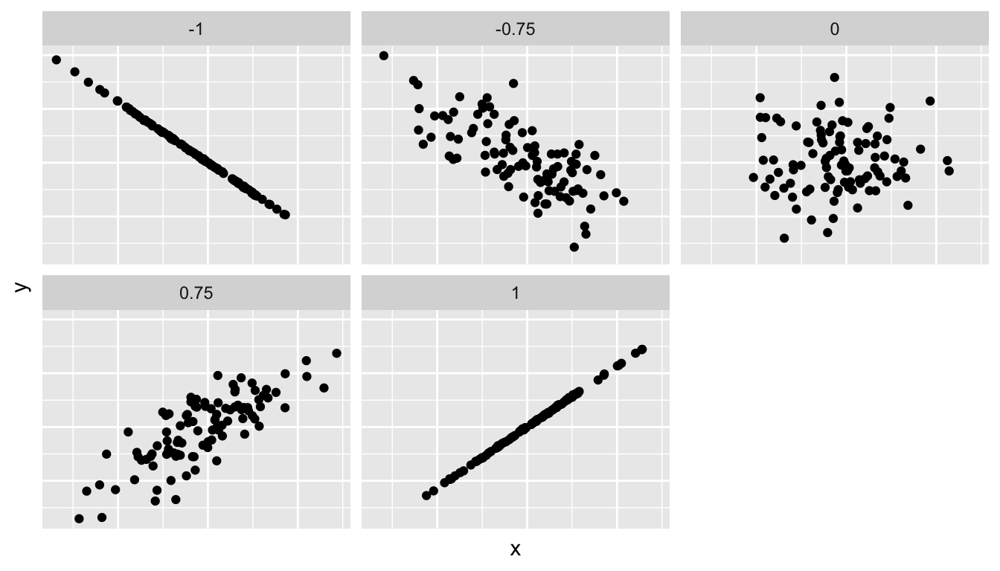

The previous chapters have focused on calculating statistics (mean, median, proportions, etc) to describe data collected from samples drawn from larger populations of individuals.

> A **population is the complete set** of all units being studied, whereas a **sample is a smaller subset** drawn from that population.

Strictly speaking, any substantive conclusions about such statistics can only describe with any **certainty** the features of the sample itself rather than to the population from which it had been drawn. In practice, however, the objective of conducting quantitative social research is to understand features of the wider population. Drawing conclusions about about populations based on sample data - a process we will call inference - is not straightforward and requires thinking clearly and systematically about uncertainty.

This unit offers an applied introduction to statistical inference. It will explain what uncertainty is, where it comes from and what shapes it, what role it plays in quantitative social research and how to factor it in our analysis.

## Sampling and uncertainty

In this chapter, we move on to examine how a **sample** **statistic** (means, proportions, etc) calculated from our data can be used to learn about features of the **population**. These features of the population we will call the **population parameters.**

To **estimate** is to make an informed guess about the approximate value of a population parameter, which is generally assumed to be fixed and unknown, based on a sample.

Making this guess is a crucial part of a broader process called **inference which is defined as**

> *the process of using the **facts we know** to learn about **facts we do not know**. The facts we do not know are the subjects of our **research questions, theories or hypotheses**. The facts we know form our **data or observations**".* [@king1994, pp. 46]

Statistical inference about a population is hard precisely because the population parameters are not known or unknowable. This is because it is unfeasible to collect data about every single unit of a population. For instance, if we would like to figure out what percentage of the population of the UK has been a victim of crime in the past 12 months we would not collect data of the roughly 69.5 million that live in it, but from a much smaller sample, perhaps a few thousand.

Thus, we will rely often on a single sample to make that informed guess of the population parameter. The problem, however, is that multiple samples **from the same population** will yield **different point estimates** for those statistics. This is known as **sampling variation.**

If every time we sample from a population we potentially get different answers to the same question, how can we be sure that any individual sample is giving us a sufficiently good approximation of the population parameter?

> The bad news is we cannot be 100% sure, the good news is that we can quantify our uncertainty about our estimates thanks to well known properties of random sampling.

To understand the problem of inference from sample to population, it's very useful to imagine a situation where the population is known - that is, we have collected data on every single unit - and then apply what we have learnt to the much more common situation where the population parameters are either unknown or unknowable.

Let's approach it by simulating a population, in this case, the full electorate of the 2016 EU Membership Referendum which contains the number of eligible voters who voted to Remain (16,141,241 or 48.11%) and those who voted to Leave (17,410,742 or 51.89%).

```{r}
#| message: false
#| warning: false
#| echo: false

library(tidyverse)
library(infer)
library(waffle)
library(knitr)
library(patchwork)
library(kableExtra)
library(ggforce)

set.seed(666)

brex <- 
  tibble(
    vote = factor(
      c("Leave", "Remain"),
      levels=c("Leave", "Remain")
    ),
    share = c(52, 48))


ggplot(brex, aes(fill = vote, values = share)) +
  geom_waffle(n_rows = 10, make_proportional = TRUE) +
  coord_equal() +
  scale_fill_manual(values = c(Leave="dodgerblue2",
                               Remain="gold")) +
  theme_void() +
  theme(legend.position="bottom", 
        legend.title = element_blank()) +
  labs(title = "2016 UK EU Membership Referendum")
```

Now we will draw **multiple** **random samples** of 1,000 voters each from that population and calculate the proportion of Leave voters for each sample - the latter will be our **point estimates**. Let's have a look at the first 15:

```{r}
#| message: false
#| warning: false
#| echo: false

leave <- sample(rep(c(0, 1), 
                    times = c(16141241, 17410742)))
ref <- tibble(leave)

slices <- ref |>
  rep_slice_sample(n = 1000, reps = 10000)

slices |>
  group_by(replicate) |>
  summarize(prop_leave = 
              mean(leave == 1)*100) |> 
  filter(replicate < 15 ) |> 
  mutate(diff = prop_leave - 51.89) |> 
  kable(format = "html", align = c("c","c")) |> 
  kable_styling(bootstrap_options = "condensed", full_width = FALSE)
```

As you can see, some of point estimates are greater (over-estimates) and some are smaller (under-estimates) than the population proportion for the whole electorate on that day 51.89%. This is a demonstration of sampling variation at work - to restate, **each sample will produce a different estimate of whatever it is we want to know about the population.**

Note though that these different estimates are not terribly far from the population proportion, the lowest estimate is 49.1 or 2.21% points under and the highest estimate is 54.1% or 2.21% points over. In other words they provide a reasonably good guess of the outcome - e.g. only in two of the first fifteen samples did Remain win.

These early observations reflect two important properties of random sampling:

- Multiple random samples will produce different estimates, but...

- estimates based on random samples will tend to cluster around the population parameter

These properties are pointing to the idea of **sampling distribution** (not to be mistaken by sample distribution), that is, the idea that the estimates of repeated samples from the same population will tend to take a particular shape, that of a Normal distribution.

Let's see what this means in practice:

```{r}
#| message: false
#| warning: false
#| echo: false
slices |>
  group_by(replicate) |>
  summarize(prop_leave = 
              mean(leave == 1)) |> 
  ggplot(aes(x=prop_leave)) +
  geom_histogram(alpha = .5, fill = "dodgerblue2") +
  geom_vline(xintercept = 0.5196, color = "red") +
  labs(x = "% Leave vote",
       y = "Number of samples",
       title = "Share of Leave vote across 10,000 samples") +
  theme_bw()
```

Indeed, as the sample size increases the average of sample estimates will converge closer and closer to the population parameter. It does not even take particularly large sample sizes, for the estimate to get pretty close as shown below:

```{r}
#| echo: false
#| message: false
#| warning: false

N <- 100000
p_pop <- 0.519

population <- rbinom(N, 1, p_pop)

# One large random ordering of the electorate
draw <- sample(population)

results <- tibble(
  n = 1:N,
  cumulative_prop = cumsum(draw) / n
)

ggplot(results %>% filter(n <= 5000),
       aes(n, cumulative_prop)) +
  geom_line(colour = "#2166ac", linewidth = 1) +
  geom_hline(
    yintercept = mean(population),
    colour = "#b2182b",
    linetype = "dashed",
    linewidth = 1
  ) +
  scale_y_continuous(
    labels = scales::percent_format(accuracy = 1)
  ) +
  labs(
    title = "Sample Proportion Converges on the Population Parameter",
    subtitle = "The dashed line shows the true Leave proportion in the electorate",
    x = "Sample size",
    y = "Sample proportion (Leave)"
  ) +
  theme_minimal(base_size = 14)
```

And finally, observe what happens as we increase the sample size of these samples:

```{r}
#| echo: false
#| message: false
#| warning: false

p1 <-
  slices |>
  group_by(replicate) |>
  summarize(prop_leave = 
              mean(leave == 1)) |> 
  ggplot(aes(x=prop_leave)) +
  geom_histogram(alpha = .5, fill = "dodgerblue2") +
  geom_vline(xintercept = 0.5196, color = "red") +
  stat_summary(aes(xintercept = after_stat(x), y = 0), fun = mean, geom = "vline", orientation = "y") +
  labs(x = "% Leave vote",
       y = "Number of samples",
       title = "n = 1000") +
  xlim(0.2, .8) +
  theme_bw()

p2 <- 
  ref |>
  rep_slice_sample(n = 200, reps = 10000) |> 
  group_by(replicate) |>
  summarize(prop_leave = 
              mean(leave == 1)) |> 
  ggplot(aes(x=prop_leave)) +
  geom_histogram(alpha = .5, fill = "dodgerblue2") +
  geom_vline(xintercept = 0.5196, color = "red") +
  stat_summary(aes(xintercept = after_stat(x), y = 0), fun = mean, geom = "vline", orientation = "y") +
  labs(x = "% Leave vote",
       y = "Number of samples",
       title = "n = 200") +
  xlim(0.2, .8) +
  theme_bw()

p3 <- 
  ref |>
  rep_slice_sample(n = 50, reps = 10000) |> 
  group_by(replicate) |>
  summarize(prop_leave = 
              mean(leave == 1)) |> 
  ggplot(aes(x=prop_leave)) +
  geom_histogram(alpha = .5, fill = "dodgerblue2") +
  geom_vline(xintercept = 0.5196, color = "red") +
  stat_summary(aes(xintercept = after_stat(x), y = 0), fun = mean, geom = "vline", orientation = "y") +
  labs(x = "% Leave vote",
       y = "Number of samples",
       title = "n = 50") +
  xlim(0.2, .8) +
  theme_bw()

p1 + p2 + p3
```

Which brings us to an important aspect in how we think about sampling and estimates. Estimates from random samples will tend to approximate the population parameter fairly well over the long run, i.e. they tend to be **unbiased.** Yet the shape of their sampling distribution will be wider or narrower (more or less precise) depending on the amount of data you are drawing from the population. What's critical here is that after a certain number of observations the amount of data will make very little difference to whether your estimate captures the quantity of interest!

```{r}
#| echo: false
#| message: false
#| warning: false

# =====================================================
# Panel labels
# =====================================================

panel_levels <- c(
  "Biased\nPrecise",
  "Unbiased\nPrecise",
  "Biased\nImprecise",
  "Unbiased\nImprecise"
)

targets <- tibble(
  panel = factor(panel_levels, levels = panel_levels)
)

# =====================================================
# Target rings
# =====================================================

outer <- targets %>%
  mutate(x0 = 0, y0 = 0, r = 10)

middle <- targets %>%
  mutate(x0 = 0, y0 = 0, r = 6.8)

inner <- targets %>%
  mutate(x0 = 0, y0 = 0, r = 3.5)

centre <- targets %>%
  mutate(x0 = 0, y0 = 0, r = 1)

# =====================================================
# Shot patterns
# =====================================================

# Biased + Precise
p1 <- tibble(
  x = c(-3.1,-2.8,-3.0,-2.9,-3.2,-3.0,-2.7,-3.1,-2.9,-3.0),
  y = c( 3.0, 3.1, 2.9, 3.2, 3.1, 2.8, 3.0, 2.9, 3.1, 3.0),
  panel = "Biased\nPrecise"
)

# Unbiased + Precise
p2 <- tibble(
  x = c(-0.3,-0.1,0.0,0.2,-0.1,0.1,0.3,-0.2,0.0,0.1),
  y = c( 0.1,-0.2,0.0,0.1,0.3,-0.1,-0.2,0.2,0.0,-0.1),
  panel = "Unbiased\nPrecise"
)

# Biased + Imprecise
p3 <- tibble(
  x = c(
    -7.5,-6.2,-5.0,-3.8,
    -5.8,-4.1,-2.5, 0.5,
    -1.8,-4.7,-5.1,-1.1
  ),
  y = c(
    6.5, 2.8, 8.0, 4.0,
    0.4, 3.5, 5.8, 3.2,
    -1.2, 5.1, 1.8, 0.8
  ),
  panel = "Biased\nImprecise"
)

# Unbiased + Imprecise
p4 <- tibble(
  x = c(
    -3.0,-2.0,-1.2,
    0.2, 2.3, 3.5,
    -1.5, 1.8,-0.4,
    0.5, 2.0, 0.0
  ),
  y = c(
    2.0,-1.8, 3.6,
    -0.8, 1.7,-1.3,
    0.9,-0.4,-2.3,
    4.0,-3.0, 1.5
  ),
  panel = "Unbiased\nImprecise"
)

shots <- bind_rows(p1, p2, p3, p4) %>%
  mutate(panel = factor(panel, levels = panel_levels))

# =====================================================
# Main target plot
# =====================================================

target_plot <- ggplot() +
  
  # Outer red ring
  geom_circle(
    data = outer,
    aes(x0 = x0, y0 = y0, r = r),
    fill = "#FF1020",
    colour = "black",
    linewidth = 0.3
  ) +
  
  # White middle
  geom_circle(
    data = middle,
    aes(x0 = x0, y0 = y0, r = r),
    fill = "white",
    colour = NA
  ) +
  
  # Inner red target
  geom_circle(
    data = inner,
    aes(x0 = x0, y0 = y0, r = r),
    fill = "#FF1020",
    colour = "black",
    linewidth = 0.3
  ) +
  
  # Centre
  geom_circle(
    data = centre,
    aes(x0 = x0, y0 = y0, r = r),
    fill = "white",
    colour = "black",
    linewidth = 0.3
  ) +
  
  # Bullseye cross
  geom_segment(
    data = targets,
    aes(x = -0.65, xend = 0.65,
        y = -0.65, yend = 0.65),
    linewidth = 0.4,
    colour = "grey40"
  ) +
  
  geom_segment(
    data = targets,
    aes(x = -0.65, xend = 0.65,
        y = 0.65, yend = -0.65),
    linewidth = 0.4,
    colour = "grey40"
  ) +
  
  # Shots
  geom_point(
    data = shots,
    aes(x, y),
    colour = "black",
    alpha = .7,
    size = 2.5
  ) +
  
  facet_wrap(
    ~panel,
    ncol = 2
  ) +
  
  coord_fixed(
    xlim = c(-11, 11),
    ylim = c(-11, 11)
  ) +
  
  theme_void() +
  
  theme(
    strip.text = element_text(
      size = 16,
      face = "bold",
      lineheight = 0.9
    ),
    panel.spacing = unit(1.2, "cm"),
    plot.margin = margin(0, 0, 0, 0),
    plot.background = element_rect(
      fill = "grey92",
      colour = NA
    ),
    panel.background = element_rect(
      fill = "grey92",
      colour = NA
    )
  )
target_plot
```

### WHAT IF WE DO NOT HAVE A POPULATION?

True population parameters are assumed to be unknown because we cannot calculate them directly. We can however take an informed guess as to what their likely values are based on our data. This process is called *estimation.*

Faced with this fact, how confident can we be that estimated sample quantities are a good approximation to the true but unknown/unknowable population values?

## Representing uncertainty

**Sampling variability** means that every time we sample from a population we will get different samples and therefore different estimates of the population parameter. Thus, the key to doing inference is to understand how such estimates vary across multiple repeated samples from the same population. This is known as the **sampling distribution**.

The problem is, however,that more often than not we can only get one sample, so we need to attempt to describe the sampling distribution of our estimate drawing from our sample data alone via simulation (bootstrapping) or via probability theory (the CLT)

Measuring uncertainty is inherently relative - i.e. we are making a judgment about our sample relative to some benchmark.

Typically, our questions about the uncertainty of our sample estimates refer to whether they are more or less close to what we would expect under some value that summarises a hypothetical distribution.

In this case we will compare the sample estimate of the proportion of leave voters against the proportion of leave voters in an imaginary world where the referendum was a tie.

### Bootstrapping

The bootstrap is a technique that involves drawing sub-samples (with replacement) from your data to generate the sampling distribution of your estimate:

- Draw one observation from your sample, record its value and put it back in the sample

- Repeat the same sampling with replacement until you have a sample of equal size as the original data and then calculate quantity of interest

- Repeat the process until you have a very large number of bootstrapped samples and estimates

```{r}
#| echo: false
set.seed(236440)
ref_big <- ref |> 
  slice_sample(n = 4200)
ref_big$leave[ref_big$leave == 1] <- "Leave"
ref_big$leave[ref_big$leave == 0] <- "Remain"
ref_big$leave<- as.factor(ref_big$leave)

null_dist <-
  ref_big |> 
  specify(response = leave , success = "Leave") |> 
  hypothesize(null = "point", p = .50) |>
  generate(reps = 10000, type = "draw") |> 
  calculate(stat = "prop") 


```

Where does the sample estimate fit?

```{r}
obs_prop_big <-
  ref_big |> 
  specify(response = leave, success = "Leave") |>
  calculate(stat = "prop")

obs_prop_big

null_dist |> 
  visualise()  +
  labs(title = "Null distribution with sample proportion") +
  shade_p_value(obs_stat = obs_prop_big, direction = "two-sided")

```

### Central Limit Theorem

```{r, echo=FALSE, message=FALSE, warning=FALSE}
# Generate data for a standard normal distribution and 1/2 SD range

density <- density(rnorm(100000), n = 100)
density <- tibble(x = density$x,
                  y = density$y)

density_sd <- density %>%
  filter(x >= -1 & x <= 1)

density_sd2 <- density %>%
  filter(x >= -2 & x <= 2)

# Plot
ggplot() +
  aes(x = x,
      y = y) +
  geom_area(data = density_sd2,
            fill = '#66AAD0') +
  geom_area(data = density_sd,
            fill = '#0072B2') +
  geom_segment(aes(x = min(density_sd$x), 
                   xend = max(density_sd$x), 
                   y = density_sd[density_sd$x == min(density_sd$x), ]$y, 
                   yend = density_sd[density_sd$x == min(density_sd$x), ]$y),
               size = 1,
               colour = '#FFFFFF') +
  geom_segment(aes(x = min(density_sd2$x), 
                   xend = max(density_sd2$x), 
                   y = density_sd2[density_sd2$x == min(density_sd2$x), ]$y, 
                   yend = density_sd2[density_sd2$x == min(density_sd2$x), ]$y),
               size = 1,
               colour = '#FFFFFF') +
  geom_label(aes(x = 0,
                 y = density_sd[density_sd$x == min(density_sd$x), ]$y,
                 label = '1 SD: 68%')) +
  geom_label(aes(x = 0,
                 y = density_sd2[density_sd2$x == min(density_sd2$x), ]$y,
                 label = '1.96 SD: 95%')) +
  geom_line(data = density) +
  scale_x_continuous(limits = c(-4, 4)) +
  labs(x = '\nStandard deviation',
       y = 'Density\n') +
  theme(plot.title = element_text(size = 17),
        axis.text = element_text(size = 17),
        axis.title = element_text(size = 17),
        axis.ticks = element_blank(),
        panel.grid.major = element_line(colour = 'gray80', 
                                        size = 0.3),
        panel.background = element_blank())
```

## Bivariate inferences

### Differences in means

In standard quant methods courses, students are often taught a number of bivariate hypothesis tests prior to regression. In most of the social sciences, most of those tests are rarely used in the stand-alone form in applied work in part because they impose very restrictive assumptions about the data. Some of them, however, are worth covering because they help us understand the difference between description and inference as well as to provide a foundation for regression modelling.

Today, we will pay attention to the t-test for independent samples, which is useful to make inferences about hypothetical differences in the group means on a continuous dependent variable.

We return to the classic example of the gender pay gap using the lfs dataset

```{r, echo=FALSE, include=FALSE, fig.align="center", warning=FALSE, message=FALSE}
library(knitr)
library(foreign)
library(ggplot2)
library(ggdag)
library(dagitty)

load("lfs.rda")
lfs$HOURPAY[lfs$HOURPAY<1]<-NA
#log-transform hourly pay
lfs$loghrpay<-log(lfs$HOURPAY) 

# We declare missing values for all individuals with a number of hours lower than 1 hour.
lfs$TOTHRS[lfs$TOTHRS<1]<-NA

# We also recode the variable NSECMJ10 into a variable called class with only 2 categories. 

lfs$class<-NA

lfs$class[lfs$NSECMJ10=="Higher managerial and professional" | 
            lfs$NSECMJ10== "Lower managerial and professional"] <- 1

lfs$class[lfs$NSECMJ10=="Intermediate occupations" | 
            lfs$NSECMJ10== "Small employers and own account workers" |
            lfs$NSECMJ10=="Lower supervisory and technical" |
            lfs$NSECMJ10=="Semi-routine occupations" |
            lfs$NSECMJ10=="Routine occupations"] <- 2

lfs$class<-as.factor(lfs$class)
levels(lfs$class)<-c("Manager & Professionals", "Intermediate/ lower")


#And finally we drop all invalid levels for variable SEX (don't knows, etc)

lfs$occup<-lfs$NSECMJ10
lfs$occup[lfs$occup=="Never worked, unemployed, and nec"]<-NA
lfs$occup[lfs$occup=="Does not apply"]<-NA

lfs$occup<-droplevels(lfs$occup)
lfs$SEX<-droplevels(lfs$SEX)

load("pse_omni.Rdata")
library(gt)
library(gtsummary)
library(tidyverse)
bes<-read.csv("bes_qstep.csv",  header=TRUE)

# Whether voted in previous general election?
table(bes$vote05)
bes$vote05 <- factor(bes$vote05)
levels(bes$vote05) <- c("Not Voted", "Voted")
table(bes$vote05)

# Gender
table(bes$gender)
bes$gender <- factor(bes$gender)
levels(bes$gender) <- c("Male", "Female")
table(bes$gender)

# Whether owner or renting?
table(bes$tenure)
bes$tenure <- factor(bes$tenure)
levels(bes$tenure) <-c ("Owner","Rental")
table(bes$tenure)

# Occupational class 
table(bes$class) 
bes$class<-as.factor(bes$class)
levels(bes$class)<-c("Professional/HigherTechnical",
                     "Manager/Senior Admin",
                     "Clerical",
                     "Sales/services",
                     "Small business owner",
                     "Foreman/supervisor",
                     "Skilled Manual",
                     "Semi/Unskilled Manual")
#table(bes$class) 

#Education level
table(bes$education)
bes$education<-factor(bes$education)
levels(bes$education)<-c("Graduate/PG", "A-level/FE/HE",
                         "GCSE A-C", "Below GCSE A-C")
#table(bes$education)
bes$education[bes$education==1]<-"Graduate/PG"
bes$education[bes$education==2]<-"A-level/FE/HE"
bes$education[bes$education==3]<-"GCSE A-C"
bes$education[bes$education==4]<-"Below GCSE A-C"
#table(bes$education)

```

```{r, echo=FALSE, fig.align="center", warning=FALSE, message=FALSE}
# Density plot for sex differences in pay
ggplot(data=lfs, aes(x=loghrpay, color=SEX)) + geom_density()

```

```{r, echo=FALSE, fig.align="center", warning=FALSE, message=FALSE}
# Boxplot for sex differences in pay
ggplot(data=lfs, aes(y=loghrpay, x= SEX)) + geom_boxplot()

```

We can formalise this comparison using the t-test. A t-test is a hypothesis test so let's specify those hypotheses first:

1.  Null or Ho: There is no difference in hourly pay between men and women - i.e. the difference between means is 0.

2.  Alternative or Ha: There is a significant difference in hourly pay between men and women - i.e. the difference between means is different from 0.

The t-test will calculate a t-statistic that measures the difference between:

a.  Observed difference: the difference in mean earnings between men and women in our data (mean of men earnings - mean of women earnings)

b.  Expected or Null difference: the difference that we would expect there to be between men and women's mean earnings ifthe null hypothesis were true - i.e. that there is no relationship between sex and earnings and therefore that the difference is 0.

The formula is as follows:

$$t=\frac{\hat{y}_{male}-\hat{y}_{female} - 0}{\sqrt{\frac{s^2_{male}}{n_{male}}+\frac{s^2_{female}}{n_{female}}}}$$

And is better understood as:

$$t=\frac{\text{difference in means} - \text{null value}}{\text{standard error of the difference}}$$

We can derive a p-value that estimates the probability that a sample would produce differences in mean earnings as large as those observed if the null hypothesis were true. In other words, how likely it is that we observe such differences in earnings if it is true that women and men earn the same amount per hour.

This series of steps only take one single line of code in R.

```{r}
t.test(lfs$loghrpay~lfs$SEX)
```

The output includes quite a bit of information. Let's break it down.. First we get the group means for men and women.

- men's mean log pay: 2.482940 & women's mean log pay: 2.296094

Then the value of the t-statistic, the degrees of freedom and associated p-value.

- t = 17.801, df = 11207, p-value \< 2.2e-16

Notice that the p-value is very small, which indicates that the difference between men and women's earnings is statistically significant and therefore we reject the null hypothesis. Notice also that the p-value is expressed in scientific notation as 2.2e-16 which is approximately 0.00000000000000022

- \[0.1662716, 0.2074206\]

This is the 95% confidence interval for the difference in means, i.e. the plausible values for the population difference in means. We are 95% confident that the population difference in log pay between men and women is between 0.166 and 0.207. Since the CI does not contain 0, we are highly confident this is a significant difference.

## Correlation between 2 continuous variables

Why does inequality vary cross-nationally?

```{r, echo=FALSE, fig.align="center", warning=FALSE, message=FALSE}

welfare<-read.spss("welfare.sav", to.data.frame=TRUE)

ggplot(data=welfare, aes(y=postginioecd, x=reorder(id, postginioecd))) + 
  geom_point() + xlab("Countries") + ylab("Post-Distribution Gini Coefficient") + 
  coord_flip() + geom_hline(yintercept = mean(welfare$postginioecd), color="blue")

```

Suppose we want to explain why some countries are more equal or less unequal than others. Here are two possible explanations:

1.  Welfare states can contribute to lower inequalities because they redistribute incomes across different groups in the population via taxation and cash transfers. While some welfare states are more progressive than others in that a larger share of the redistribution goes from rich to poor, we **hypothesize that on average the larger the size of the welfare state, measured as social expenditure, the less unequal a country will be**.

2.  Strong trade unions can contribute to lower pre-distribution inequalities, and consequently to lower post-distribution inequalities, because they have the capacity to negotiate up the wages of ordinary workers. The share of workers that are members of a trade union, or union density, is one of the key determinants of union's power to push employers and governments to lift wages before welfare state redistribution even occurs. Thus, **we hypothesize that on average the higher the union density the less unequal the country will be**.

3.  ALSO: we suspect that **social expenditure and union density are positively associated**!

```{r, echo=FALSE, fig.align="center"}

ggplot(data=welfare, aes(y=socx_pub, x=reorder(id, socx_pub))) + geom_point() +
  xlab("Countries") + ylab("Social Expenditure (% GDP)") + coord_flip() +
  geom_hline(yintercept = mean(welfare$socx_pub), color="blue")

```

```{r, echo=FALSE, fig.align="center"}

ggplot(data=welfare, aes(y=ud, x=reorder(id, ud))) + geom_point() +
  xlab("Countries") + ylab("Union Density (% Workforce)") + coord_flip() +
  geom_hline(yintercept = mean(welfare$ud), color="blue")
```

```{r, echo=FALSE, fig.align="center"}
ggplot(data=welfare, aes(x=socx_pub, y=postginioecd, label=id)) + geom_point() + 
  geom_text(hjust=0, check_overlap = TRUE) +
  ylab("Post-distribution Gini Coefficient") + xlab("Social Expenditure (% GDP)")
```

```{r, echo=FALSE, fig.align="center"}
ggplot(data=welfare, aes(x=ud, y=postginioecd, label=id)) + geom_point() + 
  geom_text(hjust=0, check_overlap = TRUE) +
  ylab("Post-distribution Gini Coefficient") + xlab("Union Density (% Workforce)")
```

```{r, echo=FALSE, fig.align="center"}
ggplot(data=welfare, aes(x=socx_pub, y=ud, label=id)) + geom_point() + 
  geom_text(hjust=0, check_overlap = TRUE) +
  ylab("Union Density (% Workforce)") + xlab("Social Expenditure (% GDP)")
```

To measure the strength and direction of association between 2 continuous variables we use the **correlation coefficient**.

To calculate it we first need to measure the covariance, which is essentially the joint variance of the two variables simultaneously. In other words, how do these variables vary together which is calculated by averaging the multiplication of the errors each observation's values for x and y relative to their means - i.e. the distance between each data point and the means of each variable x and y. Notice how similar the formula for the covariance is to that of the variance discussed in unit 3.

The formula is as follows:

$$cov(x,y)=s_{xy}=\frac{\Sigma^n_{i=1}(x_i-\bar{x})\times(y_i - \bar{y})}{n-1}$$

Graphically, we already know what variances capture

```{r, echo=FALSE, fig.align="center"}
socx_var <- ggplot(data=welfare, aes(x=socx_pub, y=postginioecd)) + geom_point() + 
  ylab("Post-distribution Gini Coefficient") + xlab("Social Expenditure (% GDP)") +
  geom_hline(yintercept = mean(welfare$postginioecd), color="blue") +
  geom_segment(aes(x=socx_pub, y=postginioecd, xend = socx_pub, yend = mean(postginioecd)), color="blue") 

gini_var <- ggplot(data=welfare, aes(x=socx_pub, y=postginioecd)) + geom_point() + 
  ylab("Post-distribution Gini Coefficient") + xlab("Social Expenditure (% GDP)") +
  geom_vline(xintercept = mean(welfare$socx_pub), color="red") +
  geom_segment(aes(x=socx_pub, y=postginioecd, xend = mean(socx_pub), yend = postginioecd), color="red") 
library(patchwork)
socx_var + gini_var 
```

But now for the covariance we consider both variances simultaneously:

```{r, echo=FALSE, fig.align="center"}
ggplot(data=welfare, aes(x=socx_pub, y=postginioecd)) + geom_point() + 
  ylab("Post-distribution Gini Coefficient") + xlab("Social Expenditure (% GDP)") +
  geom_hline(yintercept = mean(welfare$postginioecd), color="blue") +
  geom_segment(aes(x=socx_pub, y=postginioecd, xend = socx_pub, yend = mean(postginioecd)), color="blue") + 
  geom_vline(xintercept = mean(welfare$socx_pub), color="red") +
  geom_segment(aes(x=socx_pub, y=postginioecd, xend = mean(socx_pub), yend = postginioecd), color="red") 
```

The **correlation coefficient** is basically a standardised covariance so that it takes values **between -1 and +1** so that the association can be measured regardless on the metric of the variable (kg, m, number of years, salary in pounds, etc).

The Pearson's correlation coefficient (r) is calculated by dividing the covariance of x and y ($s_{xy}$) by the product of the standard deviations of x and y ($s_x \times s_x$):

$$corr(x,y)=\frac{s_{xy}}{s_x \times s_y}$$

The regression coefficient indicates two fundamental properties of an association:

1.  Strength of the relationship: based on how closely aligned the data points are and indicated by how close the number is to 0 or 1. The closer to 0 the weaker the relationship, the closer to 1 the stronger the relationship between X and Y.

2.  Sign of the relationship: based on direction of the cloud of data points (upwards, downwards, flat) and indicated by the sign of the correlation coefficient.

Graphically, this is:

```{r  out.width = "60%", echo=FALSE, fig.align="center"  }

```

R will do this for you (including a t-test with Ho that the correlation coefficient is 0) with this simple line:

```         
cor.test(variable1, variable2, use="complete.obs")
```

Corr(inequality, socx)

```{r, fig.align="center"}
cor.test(welfare$postginioecd, welfare$socx_pub, use="complete.obs")
```

Corr(inequality, union density)

```{r, fig.align="center"}
cor.test(welfare$postginioecd, welfare$ud, use="complete.obs")
```

Corr(socx_pub, union density)

```{r, fig.align="center"}
cor.test(welfare$socx_pub, welfare$ud, use="complete.obs")
```

## Hypothesis tests for contingency tables

The main purpose of a **contingency table** is to display numerically the **cross-classification of two or more categorical variables**. In plain English, all a contingency table does is to show the number of individual observations that belong to each combination of values of two categorical variables.

The main substantive purpose of a contingency table is to describe the **patterns of association between two or more categorical variables**.

In this case, we will examine the association between housing tenure

```{r, echo=FALSE,message=FALSE, warning=FALSE }
tab1<-bes %>%
  tbl_cross(
    row = tenure, 
    col = vote05,
    missing = "no",
    margin = c("column", "row"),
    label=list(tenure ~ "Tenure", vote05 ~ "Did you vote in the 2005 GE?")) 

gtab1<-tab1%>% 
  as_gt() %>%
  tab_header(title = "Whether voted in 2005 GE by Tenure Status") %>% 
  tab_source_note(
    source_note = "Source: British Election Study 2006") 

tab2<-bes %>%
  tbl_cross(
    row = tenure, 
    col = vote05,
    missing = "no",
    margin = c("column", "row"),
    percent = "row",
    label=list(tenure ~ "Tenure", vote05 ~ "Did you vote in the 2005 GE?")) 


gtab2<-tab2%>% 
  as_gt() %>%
  tab_header(title = "Whether voted in 2005 GE by Tenure Status") %>% 
  tab_source_note(
    source_note = "Source: British Election Study 2006")


```

Findings:

- 80% of homeowners said they voted in the last general election, while 20% said they didn't.

- 57% of tenants said they voted in the last general election, while 43% said they didn't.

Bivariate inference with the chi-squared test

These differences in the electoral behaviour of homeowners and tenants seem quite large, so the next step would be to ask ourselves whether they are not just the result of sampling error? To test this we

Remember that the Null Hypothesis states that there is no association between two categorical variables or, in other words, that the distribution of one variable is the same regardless of the category of the other variables. In our case, the null hypothesis is as follows:

- There is no association between voting and housing tenure
- The distribution of voters and non-voters will be (broadly) the same across owners and non-owners.

We can use the expected and observed values to calculate the chi-squared statistic ($\chi^2$). Remember that the formula is as follows:

$$\chi^2 = \sum_{i=1}^{k}\frac{(O_i - E_i)^2}{E_i} $$

This means that the chi-squared statistic is equal to the sum of the squared differences between observed counts (data) and expected counts (null hypothesis) divided by the expected counts.

The larger the value of $\chi^2$ the greater the difference between your data and what we should expect to see if there were no relationship between the two variables of interest. The second step in the chi-squared tests addresses the following question: What is the probability that the difference between observed and expected is at least as large as that captured by chi\^2 if the null hypothesis were true?

To calculate what the expected values for our table under the assumption that the null hypothesis is true - i.e. that voting is **independent** of tenure - we draw on a fundamental notion in probability theory that says that if two events are independent, the probability of them occurring at the same time (their joint probability) is equal to the product of the probability of each event occurring separately (their marginal probabilities).

For two independent events A and B, this is formally:

$$P(\text{A} \cap \text{B}) = P(\text{A})\times P(\text{B})$$

Which can be applied as follows:

```{r, echo=FALSE,message=FALSE, warning=FALSE }

gtab1 %>% 
  tab_style(
  style = list(
    cell_fill(color = "coral3")),
  locations = cells_body(columns = 8, rows =2)) %>% 
  tab_style(
  style = list(
    cell_fill(color = "purple")),
  locations = cells_body(columns = 6, rows = 2)) %>% 
  tab_style(
  style = list(
    cell_fill(color = "yellowgreen")),
  locations = cells_body(columns = 8, rows = 4))%>% 
  tab_style(
  style = list(
    cell_fill(color = "coral3")),
  locations = cells_body(columns = 6, rows = 4)) 
```

$$P(\text{Not Voting}\cap\text{Owner}) = P(\text{Not Voting})\times P(\text{Owner}) = \\ \frac{1064 \times 2987}{4104} = 774.4074  $$

```{r, echo=FALSE,message=FALSE, warning=FALSE }
gtab1 %>% 
  tab_style(
  style = list(
    cell_fill(color = "coral3")),
  locations = cells_body(columns = 8, rows =3)) %>% 
  tab_style(
  style = list(
    cell_fill(color = "purple")),
  locations = cells_body(columns = 6, rows = 3)) %>% 
  tab_style(
  style = list(
    cell_fill(color = "yellowgreen")),
  locations = cells_body(columns = 8, rows = 4))%>% 
  tab_style(
  style = list(
    cell_fill(color = "coral3")),
  locations = cells_body(columns = 6, rows = 4)) 
```

$$P(\text{Not Voting}\cap\text{Tenant}) = P(\text{Not Voting})\times P(\text{Tenant}) = \\ \frac{1064 \times 1117}{4104} = 289.5926  $$

```{r, echo=FALSE,message=FALSE, warning=FALSE }
gtab1 %>% 
  tab_style(
  style = list(
    cell_fill(color = "coral3")),
  locations = cells_body(columns = 8, rows =2)) %>% 
  tab_style(
  style = list(
    cell_fill(color = "purple")),
  locations = cells_body(columns = 7, rows = 2)) %>% 
  tab_style(
  style = list(
    cell_fill(color = "yellowgreen")),
  locations = cells_body(columns = 8, rows = 4))%>% 
  tab_style(
  style = list(
    cell_fill(color = "coral3")),
  locations = cells_body(columns = 7, rows = 4)) 
```

$$P(\text{Voting}\cap\text{Owner}) = P(\text{Voting})\times P(\text{Owner}) = \\ \frac{3040 \times 2987}{4104} = 2212.5926  $$

```{r, echo=FALSE,message=FALSE, warning=FALSE }
gtab1 %>% 
  tab_style(
  style = list(
    cell_fill(color = "coral3")),
  locations = cells_body(columns = 8, rows =3)) %>% 
  tab_style(
  style = list(
    cell_fill(color = "purple")),
  locations = cells_body(columns = 7, rows = 3)) %>% 
  tab_style(
  style = list(
    cell_fill(color = "yellowgreen")),
  locations = cells_body(columns = 8, rows = 4))%>% 
  tab_style(
  style = list(
    cell_fill(color = "coral3")),
  locations = cells_body(columns = 7, rows = 4)) 

```

$$P(\text{Voting}\cap\text{Tenant}) = P(\text{Voting})\times P(\text{Tenant}) = \\ \frac{3040 \times 1117}{4104} = 827.4074  $$

```{r, echo=FALSE, message=FALSE}
tenvote<-table(bes$tenure, bes$vote05)
chi_tenvote<-chisq.test(tenvote, correct = FALSE)
```

This is the table of observed values (your actual data):

```{r, echo=FALSE}
round(chi_tenvote$observed,2) #observed values in the original table
```

This is the table of expected values (what the data would be like if the null hypothesis of independence were true)

```{r, echo=FALSE}
round(chi_tenvote$expected,2) #expected values under the null = row sum x column sum / grand total
```

To calculate the $\chi^2$ all you need to do is plug in the relevant values in the formula

$$\chi^2 = \sum_{i=1}^{k}\frac{(O_i - E_i)^2}{E_i} $$

So the $\chi^2$ statistic for this table is:

$$\chi^2 = \frac{(583-774.41)^2}{774.41} + \frac{(481-289.59)^2}{289.59} + \\ \frac{(2404-2212.59)^2}{2212.59} + \frac{(636-827.41)^2}{827.41} = 234.66 $$

This number captures how large the difference is between the data and the expected values across the whole table (basically the sum of squared residuals relative to the expected value for each cell).

The second step in the chi-squared tests addresses the following question: What is the probability that the difference between observed and expected is at least as large as that captured by $\chi^2$ if the null hypothesis were true? In R this is quite easy to reproduce:

```{r}
#we run a chi-squared test 
tenvote<-table(bes$vote05,bes$tenure)
chi_tenvote<-chisq.test(tenvote, correct = FALSE)
chi_tenvote

```

In this case, we find a very small p-value indicating that if the null hypothesis were true, the probability of us observing such a large difference between observed and expected values is very small. We then say that there is a significant association between vote and housing tenure.
