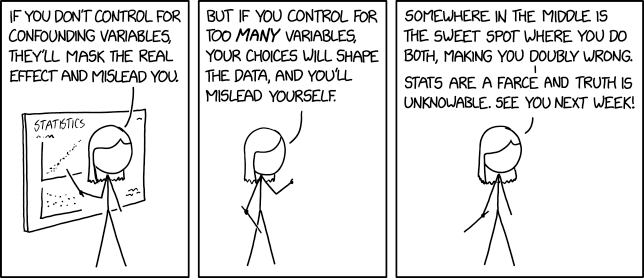
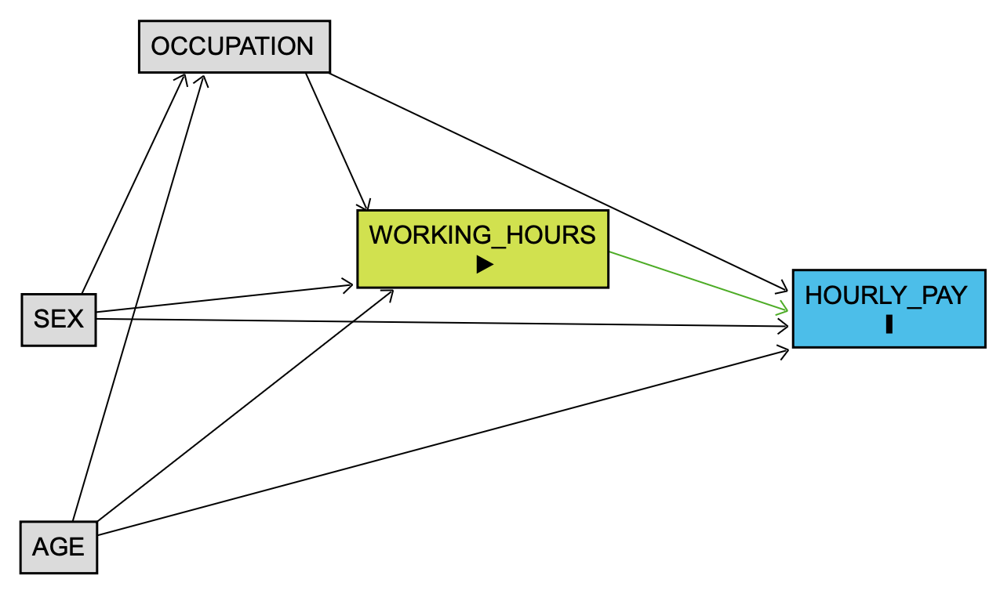

## Preliminaries

In this unit we begin our work with statistical models by introducing bivariate inference techniques (t-test and correlations) and a first attempt at how to use linear regression models in R. We will discuss each of these methods separately and show the R code that is necessary to implement them.

In terms of data and substantive rationale, we will look at the association between working hours and pay.

Our **dependent variables** will be *HOURPAY* which is measured in pounds per hour.

We will use two alternative measures of working hours as our **independent variable** to capture how they may relate two pay in different ways:

1.  **tothrs**: Total number of hours worked per week;

2.  **ftpt**: Whether working full-time or part-time.

Let's examine how these works as a directed acyclic graph or DAG - you will learn more about these in QSR2 next term - which specifies how the independent and dependent variable are associated. Notice how the arrow representing the effect goes from the independent variable *working hours* to the dependent variable *hourly pay:*

{fig-align="center"}

```{r, echo=FALSE, warning=FALSE, output = FALSE}

library(tidyverse)
library(psych)
library(janitor)
library(patchwork)
library(sjPlot)
library(car)
library(MASS)

load("lfs.rda")

# DATA PREPARATION -----
lfs <- clean_names(lfs)

#restrict age
lfs$age[lfs$age<16 | lfs$age > 67] <- NA

# we check the basic descriptive statistics:
describe(lfs$tothrs)
# We declare missing values for all individuals with a 
# number of hours lower than 1 hour.
lfs$tothrs[lfs$tothrs<1]<-NA

# is 97 a missing value?

# histogram for total hours worked
lfs |> 
  ggplot(aes(x= tothrs)) + 
  geom_histogram()


# We also recode the variable nsecmj10 into a variable called class with only 2 categories. 

table(lfs$nsecmj10)
lfs$class<-NA
lfs$class[lfs$nsecmj10=="Higher managerial and professional" | 
            lfs$nsecmj10== "Lower managerial and professional"] <- 1
lfs$class[lfs$nsecmj10=="Intermediate occupations" | 
            lfs$nsecmj10=="Lower supervisory and technical"] <- 2
lfs$class[lfs$nsecmj10=="Semi-routine occupations" |
            lfs$nsecmj10=="Routine occupations" ] <-3
lfs$class<-as.factor(lfs$class)
levels(lfs$class)<-c("Manager & Professionals", "Intermediate", "Semi-routine & Routine")
table(lfs$class)

#And finally we drop all invalid levels for variable SEX (don't knows, etc)

lfs$occup<-lfs$nsecmj10
lfs$occup[lfs$occup=="Never worked, unemployed, and nec"]<-NA
lfs$occup[lfs$occup=="Small employers and own account workers"]<-NA
lfs$occup[lfs$occup=="Does not apply"]<-NA

lfs$occup<-droplevels(lfs$occup)
table(lfs$occup)

lfs$sex<-droplevels(lfs$sex)
table(lfs$sex)

table(lfs$ftpt)
lfs$ftpt[lfs$ftpt == "Does not apply" ] <- NA
lfs$ftpt[lfs$ftpt == "No answer" ] <- NA
lfs$ftpt <- droplevels(lfs$ftpt)

```

Before we proceed, we need to recode and transform the relevant variables, starting by the dependent variable **hourpay** (the rest of variables used have also been recoded - see workshop R script on Minerva).

As usual we describe the variable first and then check the values that need cleaning up. Notice the presence of negative values in the statistics, which are not actual income values but missing values as encoded in the LFS datase. Here we remove all earnings lower than 0 pounds per hour:

```{r}
describe(lfs$hourpay)
lfs$hourpay[lfs$hourpay<0] <- NA
describe(lfs$hourpay)
```

Next we run a quick histogram using `hist()`, though you could also use ggplot2, to see that the distribution of hourly pay is heavily right skewed - as it generally is with income and earnings distributions.

```{r}
hist(lfs$hourpay, breaks=100)
```

This is a problem for standard linear regression models (more on the issue of distribution of residuals below) so we will use a technique called logarithmic or log transformation to make the distribution of pay approximately like a normal distribution:

```{r}
#log-transform hourly pay
lfs$loghrpay<-log(lfs$hourpay)

hist(lfs$loghrpay)
```

As you can see the new variable **loghrpay** is much more symmetrical which makes it appropriate to use regression analysis.

## Bivariate inference I : 1 continuous DV and 1 categorical IV.

### Testing the difference in pay between FT and PT workers

Now that we have completed the recoding of the variables we begin by differences in pay by working hours. As usual we begin by comparing the distributions of full-time and part-time earnings by means of boxplots and density plots.

```{r, echo = FALSE, warning=FALSE}
# Density plot for sex differences in pay
p1 <-
lfs |> 
  drop_na(ftpt) |> 
  ggplot(aes(x=loghrpay, color=ftpt)) + 
  geom_density() 

# Boxplot for sex differences in pay
p2 <-
lfs |> 
  drop_na(ftpt) |> 
  ggplot(aes(y=loghrpay, x= ftpt)) + 
  geom_boxplot()

p1 + p2
```

We can formalise this comparison using the t-test we learnt about in the previous unit. A t-test is a hypothesis test so let's specify those hypotheses first:

1.  Null or Ho: There is no difference in hourly pay between full-time and part-time workers - i.e. the difference between means is 0.

2.  Alternative or Ha: There is a significant difference in hourly pay between full-time and part-time workers - i.e. the difference between means is different from 0.

The t-test will calculate a t-statistic that measures the difference between:

a.  Observed difference: the difference in mean earnings between full-time and part-time workers in our data (mean of FT earnings - mean of PT earnings)

b.  Expected or Null difference: the difference that we would expect there to be between full-time and part-time workers' mean earnings if the null hypothesis were true - i.e. that there is no relationship between FT/PT status and earnings and therefore that the difference is 0.

The formula is as follows:

$$t=\frac{\hat{y}_{FT}-\hat{y}_{PT} - 0}{\sqrt{\frac{s^2_{FT}}{n_{FT}}+\frac{s^2_{PT}}{n_{P}}}}$$

And is better understood as:

$$t=\frac{\text{difference in means} - \text{null value}}{\text{standard error of the difference}}$$

We can derive a p-value that estimates the probability that a sample would produce differences in mean earnings as large as those observed if the null hypothesis were true. In other words, how likely it is that we observe such differences in earnings if it is true that full-time and part-time workers earn the same amount per hour.

This series of steps only take one single line of code in R.

```{r}
t.test(lfs$loghrpay~lfs$ftpt)
```

The output includes quite a bit of information. Let's break it down:

- t = 17.801, df = 11207, p-value \< 2.2e-16

This indicates the value of the t-statistic, the degrees of freedom and associated p-value. Notice that the p-value is very small, which indicates that the difference between full-time and part-time average hourly earnings is statistically significant and therefore we reject the null hypothesis.

- \[0.1662716, 0.2074206\]

This is the 95% confidence interval for the difference in means. Remember that a CI indicates the range of plausible values that repeated samples would yield - i.e. to account for sampling variability. Since the CI does not contain 0, we are highly confident this is a significant difference.

- FT mean log pay: 2.48
- PT mean log pay: 2.14

These are the actual means for each group as estimated from the sample.

## Bivariate inference I : 1 continuous DV and 1 continuous IV.

Now we turn our attention to exploring how the number of hours worked are associated with hourly pay.

### Exploring bivariate associations between 2 continuous variables using the correlation coefficient

To measure the strength and direction of association between 2 continuous variables we use the correlation coefficient. To calculate it we first need to measure the covariance, which is essentially the joint variance of the two variables simultaneously. In other words, how do these variables vary together. The formula is as follows:

$$cov(x,y)=s_{xy}=\frac{\Sigma^n_{i=1}(x_i-\bar{x})\times(y_i - \bar{y})}{n-1}$$

Remember that the correlation coefficient is basically a standardised covariance so that it takes values between -1 and +1 so that the association can be measured regardless on the metric of the variable (kg, m, number of years, salary in pounds, etc).

The Pearson's correlation coefficient (r) is calculated by dividing the covariance of x and y ($s_{xy}$) by the product of the standard deviations of x and y ($s_x \times s_x$):

$$corr(x,y)=\frac{s_{xy}}{s_x \times s_x}$$

R will do this for you (including a t-test with Ho that the correlation coefficient is 0) with this simple line:

```{r}
cor.test(lfs$loghrpay, lfs$tothrs, use="complete.obs")
```

So the correlation coefficient for the association between pay and hours worked is +0.28. This indicates a positive (as hours worked increases pay also increases) but weak relation (one variable predicts the other one to a very limited extent). Notice that the p-value is also very small, so we can concluded that the correlation is significant at the 95% confidence level - it is highly unlikely that we would find a correlation of this magnitude if in the population from which the data was sampled the correlation was actually 0 (i.e. the null hypothesis).

### Exploring bivariate associations between 2 continuous variables using a scatterplot

We can explore this association graphically, using scatterplots. Scatterplots plot each individual observation as a point on the 2 dimensional space defined by two axis that represent the levels of each one of the variables. Each point represents the scores of each observation for the variable on the horizontal or x axis and variable on the vertical or y axis.

The ggplot2 syntax should be familiar to you by now. The only difference is the **geom_point** shape. Since we are dealing with a very large sample, we specify a specific shape (shape=1) for the points (a circle without fill) to make the visualisation clearer:

```{r, warning=FALSE}
ggplot(data=lfs, aes(y=loghrpay, x=tothrs)) +
  geom_point(shape=1) 
```

As we can see as the number of hours worked increases, the pay per hour also increases, but it is a neither very steep nor strong pattern. You can tell that it is not strong by the fact that the cloud of points is quite scattered - i.e. that for any number of working hours there is quite a spread in the amounts of pay our respondents receive. In other words, total hours worked does not predict very well the pay one is going to get, so there are many other factors that must be playing a role in determining pay. This is consistent with what the weak positive correlation coefficient (r=0.29) was showing.

We can also fit in a regression line to summarise the pattern of data points. We do this by introducing the geom_smooth() function and the linear model method option.

```{r, warning=FALSE, message=FALSE}
ggplot(data=lfs, aes(y=loghrpay, x=tothrs)) +
  geom_point(shape=1) + geom_smooth(method="lm") 

```

The line has a positive or upward slope indicating that on average as total hour increases, average pay per hour also increases. Notice however how far the points are from the line on average, suggesting that total hours is only a weak predictor of hourly pay.

## Simple linear regression

We will then proceed to fit simple regression models. We will begin by fitting what's known as an empty model to show a key property of linear regression models and then move on to the bivariate regression between pay and working hours.

So let us begin by making sure that we have full information on all cases. Otherwise we cannot compare models in any meaningful way. We will use the *complete.cases()* to do this

```{r}
lfs<-lfs[complete.cases(lfs$loghrpay, lfs$ftpt, lfs$tothrs, lfs$class, lfs$age, lfs$sex), ]
```

### The empty model

Now that we understand what the coefficients mean let us fit our first model. This will be an empty or null model, i.e. a model with no independent variables. We do this to highlight that the mean is also a model - a simplified representation - of our data:

$$Y_i = b_0 + e_i$$

This equation states that our DV is equal to the intercept (the sample mean) plus some error - in other words, the mean is an imperfect summary of the data. What this implies is that each of the data observations is equal to the mean plus all the differences between the mean and the actual data.

In a way, we already knew this in the sense from our discussion of the squared errors needed to calculate the standard deviation: If the errors are the data values minus the mean, then the values will be the mean plus the errors!

This is how we specify the model in R:

modelname \<- lm (dependent \~ independent, data = dataframe)

In this case we are not including an independent variable, just an intercept (\~1) so this should be as follows:

```{r}
fit0 <- lm(loghrpay~1, data=lfs)
summary(fit0)
```

This model has only one estimate - the intercept ($b_0$):

- The intercept is 2.401 with standard error 0.0057 and a very small p-value p\<0.001 which is highly significant. Remember that significance in regression is based on a t-test of the null hypothesis that the coefficient is equal to 0.

So the model predicting log hour pay is specified as:

$$\hat{Y} = 2.40$$

Which indicates that the average loghourpay is 2.40. This is an *unconditional mean* or average, i.e. it is not conditioned, controlled or adjusted for by any other factors.

Indeed if you were to take the mean of loghrpay:

```{r}
mean(lfs$loghrpay, na.rm=T)
```

You will get exactly the same: $$\bar{Y} = 2.40$$

In other words, regressing Y without predictors is equal to estimating the mean. Remember that after all, the a property of the mean is that it minimises the errors (total sum of distances between each data point and the mean), which is in essence what the regression line does (albeit with squared residuals).

### Model 1: Regressing hourly pay on working hours

This will be our first model that specifically targets our research question by regressing hourly pay on working hours ONLY. This means that the estimated mean working hours is allowed to vary by the number of working hours reported by respondents.

$Y_i = b_0 + b1 \text{tothrs} + b_2 \text{female} + e_i$

We can estimate this model in R as follows:

```{r}
fit1 <- lm(loghrpay ~ tothrs, data=lfs)
```

And you should obtain the following output:

```{r}
summary(fit1)
```

Let us describe the intercept ($b_0$) and slopes ($b_1$ and $b_2$) in the coefficients section of the regression output.

- The intercept $b_0$ is 2.02 with standard error 0.016 and a very small p-value p\<0.001 which is highly significant.

- The coefficient $b_1$ for tothrs is -0.011 with standard error 0.001 and a very small p-value p\<0.001 which is highly significant.

So the model predicting log hour pay as a function of working hours is specified as:

$$\hat{Y} = 2.02 + 0.011 \times \text{TOTHOURS} $$

How to interpret this?

Sometimes, the intercept $b_0$ is tricky to interpret, due to its lack of plausibility. For instance, in this case the intercept would be the mean hourly wages of men who work 0 hours (an out-of-sample prediction, because we only have people who work more than 1 hour).

The tothrs coefficient $b_1$ capture the **raw total effect of working hours on pay**. More specifically, that an increase in one hour of work is associated with an increase in log pay of 0.011. From this, we can say that the for each additional increase of one hour worked per hour, the average salary is associated with an increase of 0.011 in log pay.

Now, since interpreting values on log-scale can be unintuitive, we can draw on the following rule of thumb for models where the dependent continuous variable has been log-transformed while the predictors remain in the original units (see [this guide](https://kenbenoit.net/assets/courses/me104/logmodels2.pdf) for more info). When the DV is on the log scale, we can interpret the coefficients as the % increase in Y associated with one unit increase of x.

$$\hat{Y} = 2.02 + 0.011 \times \text{TOTHOURS} $$

Since $$ b_1 = 0.011 $$, this means that for an increase in one hour of work we would expect an increase in pay per hour by a multiple of $$e^{b_1} = e^{0.011} = 1.011061$$ - in other words, by 1.1%. Notice that we could also have used the rule of thumb whereby the b1 coefficient times 100 is also 1.1% - $$ b_1 x 100 = 0.011 \times 100 = 1.1\%  $$.

This is easier to understand if we plug in values into the equation:

$$\hat{Y} = 2.02 + 0.011 \times \text{tothrs} $$

Let's compare the average predicted hourly pay of someone who works an 40 hours a week

$$\hat{Y} = 2.02 + 0.011 \times 40 = 2.46$$

with that of someone working the 20 hours a week:

$$\hat{Y} = 2.02 + 0.011 \times 20 = 2.24$$

This means that the difference in (log) hourly pay between a someone working 20 and 40 hours respectively is 0.22:

```{r}
exp(0.22)
```

Which indicates that a person working 40h would earn around 25% more per hour than someone working 20 hours. Bear in mind however, that this quite a large difference that is unadjusted by many possible confounding variables and we should expect it to shrink (or attenuate) as a result of controlling for such variables.

### Model 2: Regressing hourly pay on full-time vs part-time status

We now re-specify our model full-time vs part-time status. This means that the estimated mean working hours is allowed to vary by whether the respondent is a full-time vs a part-time worker:

$Y_i = b_0 + b1 \text{part-time} + e_i$

We can estimate this model in R as follows:

```{r}
fit2 <- lm(loghrpay ~ ftpt , data=lfs)
```

And you should obtain the following output:

```{r}
summary(fit2)
```

So our model is:

$$\hat{Y_i} = 2.47 - 0.305 \times \text{part-time}$$

Notice here that the intercept has a much more direct and clear substantive meaning - namely, the average log-pay per hour of a full-time worker. This is because the intercept is the predicted value of the dependent variable when the predictor is set to 0. Logically, if part-time is set to 0 and there are only two categories, then it follows tha the intercept represents the average of the reference group (full-time work).

Meanwhile, the $b_1= - 0.305$ indicates a negative and significant effect of part-time work on pay per hour - i.e. part-time workers earn significantly less per hour than full-time workers. The difference associated with being a part-time worker as opposed to full-time is calculated by exponentiating the $b_1$coefficient

```{r}
exp(0.305)
```

So $e^{b_1} = e^{0.305} = 1.357$, indicates that part-time workers received on average 35% lower pay per hour than full-time workers. Again, a very large difference that we would expect to shrink as we control for other antecedent/confounder variables.

## Thinking about confounders

Now, we may suspect that the association between working hours and pay may be the product of other variables that are correlated with both the independent and the dependent variable.

We will consider three key **confounding variables** or **confounders** - i.e. variables that are causally responsible for both working hours AND pay, and therefore can partially account for the association between them. In general, we **will only control for confounding variables** as these are the only ones for which we can be pretty certain that by adjusting for them we will not unwittingly bias the estimation of the effect of interest. In this sense, and for the time being, we should be particularly careful **not to control or adjust for intervening or mediating variables** [@bartram2021a, @bartram2021].

{fig-align="center"}

These are our candidate controls:

1.  **sex**: Male/Female;

2.  **occup**: Occupational Class.

3.  **age**: Age in number of years

And this is how we expect them to be causally related based on relevant academic literature:

{fig-align="center"}

Let's then examine first whether these control variables are indeed associated with working hours and with hourly pay - i.e. that they are potential confounders.

### Control 1: Sex

We suspect that both the number of hours worked and pay vary by sex. If this is the case, *sex* would be a good control candidate variable for our regression model later on.

Let's examine these bivariate associations:

```{r}
t.test(lfs$tothrs~lfs$sex)
```

As expected, due to the over-representation of women in part-time work, the average number of hours worked is much lower amongst women (30.25) than men (39.81). Indeed, the 95% CI for the difference is between 9.29 and 9.82, which means that we are confident that on the average male worker spends more than 9 hours per week than the average female worker. The t-statistic (t = 70.57) has an associated p-value much smaller than 0.05 so we conclude that the difference is statistically significant.

Notice that looking at the association between working hours measured as part-time vs full-time and sex would also yield a significant association:

```{r}
ftsex<- table(lfs$ftpt, lfs$sex)
prop.table(ftsex, 2)*100
chisq.test(ftsex)
```

```{r}
t.test(lfs$loghrpay~lfs$sex)
```

Moving on to the association between pay and sex shows again a significant association:

```{r}
t.test(lfs$loghrpay ~ lfs$sex)
```

This becomes even clearer when we examine the scatterplots again, this time colouring the data points by sex:

```{r, warning=FALSE, echo=FALSE}
p3 <- 
lfs |> 
  drop_na(ftpt) |> 
  ggplot(aes(y=loghrpay, x= tothrs, color= sex)) + 
  geom_point()

p4 <- 
  lfs |> 
  drop_na(ftpt) |> 
  ggplot(aes(y=loghrpay, x= ftpt, color= sex)) + 
  geom_point()

p3 + p4
```

We can see how the male data points (red) are over-represented in the longer hours and higher pay, while female data points are over-represented in the shorter hours and lower pay side of the cloud of points. Similarly, we see an over-representations of male workers in higher-paid full-time and an over-representation of female workers on part-time in the mid and low pay. All in all, the bivariate analysis suggests that sex is plausible confounder that we should account for when assessing the association between working hours and pay.

### Control 2: Age

We will also consider age as a possible confounder, again following a similar logic and running bivariate tests for all the relevant associations with our main predictor (working hours) and dependent variable (pay).

Let's see this graphically

```{r, warning=FALSE, echo=FALSE, message=FALSE}
p5 <-
  lfs |> 
  ggplot(aes(y=loghrpay, x= age)) + 
  geom_point() +
  geom_smooth(method = "lm")

p6 <-
lfs |> 
  ggplot(aes(y = tothrs, x = age)) + 
  geom_point() +
  geom_smooth(method = "lm")

p5+p6
```

So age seems to be positively associated with pay, plausibly the result for job tenure length and work experience, but very weakly, if at all, correlated with age. Let's calculate the correlation coefficient to find out more precisely:

```{r}
cor.test(lfs$tothrs, lfs$age, use="complete.obs")

cor.test(lfs$loghrpay, lfs$age, use="complete.obs")
```

This shows that there is indeed a positive significant if weak correlation between age and pay (0.19, p-value\<0.0001),and that the correlation between age and total number of hours is significantly different from zero though very weak (0.038, p-value\<0.0001).

Finally, let's examine whether age and part-time work are correlated:

```{r}
lfs |> 
  drop_na(ftpt) |> 
  ggplot(aes(y = ftpt, x = age)) + 
  geom_point()

logit1 <- glm( ftpt ~ age, family = "binomial", data = lfs) 
summary(logit1)
```

There is no evidence of an effect of age on part-time work based on the logistic regression we have fitted. On the whole, we have some evidence that this variable could be a plausible confounder, because it correlates with the DV and the predictor, but rather weakly and only if using total working hours rather than the full-time vs part-time divide. We will however explore this further in the regression to see whether its inclusion as a control is warranted.

### Control 3: Occupation

We will also consider occupation as a possible confounder, again following a similar logic and running bivariate tests for all the relevant associations with our main predictor (working hours) and dependent variable (pay).

Let's see this graphically

```{r, warning=FALSE, echo=FALSE, message=FALSE}
p7 <-
  lfs |> 
  drop_na(occup) |> 
  ggplot(aes(y=loghrpay, x= occup )) + 
  geom_boxplot() +
  theme(axis.text.x = element_text(angle = 90))

p8 <-
  lfs |> 
  drop_na(occup) |> 
  ggplot(aes(y=tothrs, x = occup )) + 
  geom_boxplot() +
  theme(axis.text.x = element_text(angle = 90))

p7 + p8 # consolidate legend?
```

In this case, just by looking at the graps we can already tell that there are occupational differences in average working hours and hourly pay. If you needed further evidence, you could either run an analysis of variance (ANOVA) or equivalently you may want to fit a simple regression model:

```{r}
fit_pay_occup <- lm(loghrpay ~ occup, data = lfs)
summary(fit_pay_occup)
fit_hours_occup <- lm(tothrs ~ occup, data = lfs)
summary(fit_hours_occup)
```

There is a clear occupational gradient for pay - i.e. pay declines significantly as we go down the occupational scale relative to the highest occupational group - and there are also differences across occupational groups in working hours, though here there is no gradual decline from Managers to Routine workers.

For the FTPT variable, we can create a bar plot and run a chi-squared test on the contingency table (or even fit a logit model if you are feeling particularly adventurous)

```{r}
lfs |> 
  drop_na(occup, ftpt) |> 
  ggplot(aes(x = occup, fill = ftpt)) +
  geom_bar(stat = "count", position = "fill") +
  theme(axis.text.x = element_text(angle = 45, hjust = 1))

occupftpt <- table(lfs$occup, lfs$ftpt)
chisq.test(occupftpt)
```

Both the plot and the bivariate test support the intuition that occupation and FTPT status are associated. All in all, as in the case of sex, we have further evidence that FTPT could be a plausible candidate control in our regression of pay on working hours.

## Multiple regression

### Model 1c: Pay regressed on Working hours + All controls included

Now we will introduce introduce sex, class and age as controls

$$Y_i = b_0 + b1 \text{tothrs} + b_2 \text{sex} + b_3 \text{age} +  b_4 \text{occup} + e_i$$

Be aware though of how categorical predictors in a regression model are actually handled by default in R - i.e. [dummy coding](#0). This in practice means that any categorical variable is automatically transformed into a series of binary or dichotomous variables with values 0 (No) or 1 (Yes) representing each one of the categories of the original variable. These are in turn introduced as predictors in the regression model with the first dummy category omitted. This omitted category then becomes the *reference category (whose average value of the DV is contained in the intercept or constant), i.e. the category to which the coefficients for the rest of categories are compared*. So, for variable sex (male/female) there are 2 dummy variables male (0/1) and female(0/1) where only the second (female) appears in the model; meanwhile, for occupation ( 1 - higher managerial ... to 7-routine ) there will be 7 dummies, of which the first will be left out as reference group while the remaining 6 will be introduced in the model. So in practice the model with the main predictor and controls will have the following form:

$$
\begin{split}
Y_i = b_0 + b1 \text{tothrs} + b_2 \text{female} + b_3 \text{age} + \\
b_4 \text{occup2} + b_5 \text{occup3} + b_6 \text{occup4} + \\ b_7 \text{occup5} + b_8 \text{occup6} + e_i
\end{split}
$$

We can estimate this model in R as follows:

```{r}
fit1c <- lm(loghrpay ~ tothrs + sex + age + occup, data=lfs)
```

And you should obtain the following output:

```{r}
summary(fit1c)
```

We can use the function *tab_model()* from sjPlot to show the models with and without controls side by side, which will allow us to gauge how the coefficient for hour has changed after introducing controls:

```{r}
tab_model(fit1, fit1c)
```

As you can see as a result of controlling for occupation, sex and age the coefficient for the effect of working hours on pay has become much smaller (from 0.011 in model 1 to 0.003, that is the adjusted effect is just over a quarter of the raw or unadjusted effect from model 1) but it is still positive and significant. This means that while working hours are still positively associated with pay per hour holding all other variables constant, a large part of the raw association can be accounted for by variables that are causally responsible for **both** working hours and pay. Indeed, if you exponentiate the coefficient, you will see that the an additional hour of work is associated with an increase in pay of by a multiple of $e^{b_1} = e^{0.003} = 1.003$ - i.e. 0.3%.

### Model 2c: Pay regressed on Working hours + All controls included

We can also run the model with FTPT this time including controls:

```{r}
fit2c <- lm(loghrpay ~ ftpt + sex + age + occup, data=lfs)
summary(fit2c)
```

Which we can tab in a nicer form:

```{r}
tab_model(fit2, fit2c)
```

Just like in the model with total working hours as predictor, in this model the coefficient for part-time status is negative and statistically significant, but it is also much smaller than in the first version of the model without controls - from -0.30 to -0.09, less than a third. This is again the product of controlling for confounding variables that acccount for a large part of the association between work and pay. So while in the model with controls the average pay gap between full-time and part-time workers was around 35% it is now "just" 9% holding age, sex and occupation constant.

## Model Fit:

We have already seen in the output that the $R^2$ was growing as we added new variables. As models become more complex (i.e. as they capture more and more features of the reality we are trying to study) they also explain a greater share of the variance in the DV. It is useful, however, to understand where this $R^2$ statistic comes from, what does it tell us about our model and how should we use it.

The $R^2$ is a measure of model fit - i.e. of how well the regression model predicts the data. This statistic is calculated as follows:

$$R^2 = \frac{SS_M}{SS_T} = \frac{\text{Model Sum of Squares}}{\text{Total Sum of Squares}}=\frac{\text{Total Sum of Squares - Residual Sum of Squares }}{\text{Total Sum of Squares}} $$

Let's begin by explaining the **Total Sum of Squares** ($SS_T$), which you know already from calculating the Standard deviation. Indeed $SS_T$ is nothing more than the sum of squared differences of the dependent variable **Y** around the mean $\bar{Y}$, so it captures the **total amount of variation of the variable around the mean**

$$SS_T=\sum^n_{i=1}({Y_i-\bar{Y}})^2$$

To understand **Model Sum of Squares** ($SS_M$) is necessary to first make sense of the **Residual Sum of Squares** ($SS_R$). The Residual Sum of Squares is the difference between the predicted values of our dependent variable according to our model $\hat{Y}$ and the actual observed values of our dependent variable $\hat{y}$. In other words, it captures the **total amount of variation of our dependent variable around the line of best fit** or in other words, the inaccuracy of our model.

This is:

$$SS_R=\sum^n_{i=1}({Y_i-\hat{Y}})^2$$

This $SS_R$ is the value that is minimised in the regression via the method we have been using - i.e. Ordinary Least Squares or OLS regression. So the line of best fit is that which minimises the sum of distances between the data points $Y_i$ and the predicted values $\hat{Y}$ define by the regression line.

Finally, the **Model Sum of Squares** ($SS_M$) is the difference between the total sum of squares $SS_T$ and the residual sum of squares $SS_R$:

$$SS_M = SS_T - SS_R$$

To understand this think of the following:

- The mean is the simplest model of our data, so the total sum of squares tells us how well a model without predictors fits the data

- Our model with predictors is a more complex model that captures the data better, so the residual sum of squares should be smaller than the total sum of squares.

- The model sum of squares, i.e. the difference between the residual and the total sum of squares, then indicates the improvement in prediction that results from fitting the regression model with predictors in comparison to a model of the mean without predictors.

- Thus the $R^2$ captures the amount of the overall variance in the data that is captured by our model. The larger $SS_M$ is the greater improvement in model fit have resulted from adding predictors to your model and this will be reflected in a higher $R^2$.

If we now look at the 2 models we have fitted so far (we omit the one with the binary class predictor) we can see what happens to $R^2$ as we increase the number of predictors:

```{r}
tab_model(fit1, fit1c)
```

and for the categorical predictor FTPT:

```{r}
tab_model(fit2, fit2c)
```

As expected the more complex our model is (the more independent variables or predictors we incliude) the better our model gets at explaining the variation in pay. Remember that you can think of this in terms of information. Making a guess about something is much more difficult (and it is much more likely that we get it wrong) when we do not have much information about it. The more we know, the better our position is to make such guess.

## Model Diagnostics

For a regression to produce valid estimates of the coefficients there are a number of assumptions that our data and model must meet. Otherwise, there are limits to which you can make inferences about the data and generalise your findings.

These assumptions do not concern the overall fit of the model, but rather how well the model predicts specific observations or range of observations.

|  |
|:-----------------------------------------------------------------------|
| Note: |
| In terms of the code, you can use all the syntax below in your own analysis by just changing the names of the models. So if you have named your model *mod5* then you need to replace all the *fit2* in the syntax for *mod5*. |

### Assessing outliers and influential observations

The OLS regression method assumes that no data points are so large or so small that they influence the estimation of the regression coefficients. If there were extreme values or outliers we should make sure they did not significantly bias the parameter estimates.

We begin by identifying outliers - i.e. cases that differ substantially from the main trend of the data. These are values which are far away from the regression line - they are heavily under or overpredicted - and therefore have very large residuals ($Y_i-\hat{Y}$).

To formally identifies outliers we can use the function **outlierTest()** which runs a Bonferroni Test (a type of t-test). If the p-value is smaller than 0.05 we will consider such observations as outliers:

```{r}
# Assessing Outliers
outlierTest(fit1c, n.max=100) # Bonferonni p-value 
```

We find that there are a number of potential regression outliers in our data.

The next question is whether these outliers affect in any way the regression model - in other words, whether because of their discrepancy with the pattern, they could be shifting the slope and the intercept of our model.

A useful indicator of leverage of a data point can be calculated by checking how the predicted value would change if we moved that point one unit in the vertical (y) direction. This measure would take values from 0 (no effect on the regression model) to 1 (the regression line is forced to go through that point). In R this is achieved with the **hat()** function the values of which we can plot:

```{r}
levfit1c <- hat(model.matrix(fit1c))
mean(levfit1c)
plot(levfit1c)
```

The plot shows that there is at least one point that is quite far from the main cloud of points, but also that its leverage is quite close to 0 so it does not look as if it could greatly influence our model.

We can also use Cook's distance to measure influence. Typically, points with a Cook's distance greater than 1 would require our attention. Let's do this in R:

```{r}
cook = cooks.distance(fit1c)
plot(cook,ylab="Cook's distances") 
```

Again, we get a similar story with Cook' distance varying across observations, but on average being quite close to 0.

How is it that our outliers seem to have little effect influence on the model? This is mainly the result of having a very large sample size. The larger the number of observation, the less likely it will be that a single data point can bias the regression estimates.

### Normality of residuals

The linear regression model also assumes that the error term in the regression equation is normally distributed. By extension, this means that the regression residuals should also be approximately normally distributed. The easiest way to check such normality assumption is to plot the residuals and inspect them.

We begin by producing a quantile-comparison or quantile-quantile (QQ) plot. This type of graph plots the residuals of your model against the values of the Normal (or the t-distribution). If your model residuals are normally distributed they will largely fall on a straight line. To do this use the **qqPlot()** function:

```{r}
# qq plot for studentized residuals
qqPlot(fit1c, main="QQ Plot for Regression Model 4")
```

You can see that the residuals fall nicely on the straight line for most of the distribution of residuals but that at both extremes the dots representing the residuals begin to move away from the line - downwards at the lowest and upwards at the highest. This means that the distribution of our residuals has slightly heavy tails - the tails have more observations that you would expect if the residuals were truly Normal. You can see this by plotting a histogram of the residuals:

```{r}
# distribution of studentized residuals
sresid <- studres(fit1c) 
hist(sresid, freq=FALSE, 
     main="Distribution of Studentized Residuals")
xfit<-seq(min(sresid),max(sresid),length=1000) 
yfit<-dnorm(xfit) 
lines(xfit, yfit)
```

All in all, however, the residuals are distributed approximately like a Normal distibution so our model seems adequate. You should be more concerned if you found that the majority of points do not fall nicely on the line!

|  |
|:-----------------------------------------------------------------------|
| Note |
| If we had not done the log-transformation of our dependent variable we would have had serious issues of non-normality with the residuals that would have made our model problematic. This is why it is so important that we examine the distribution of the dependent continuous variable, and potentially transform it, before we build the linear regression model. |

### Constant Variance of Residuals

The next assumption our model must meet is that the spread of the residuals has to be constant across different levels of the predicted values. This is known as the "homoscedasticity" or constant variance assumption. The reason why this matters is that if residuals are larger for some predicted values than others, this means that our model is better at describing some parts of the data than others!

```{r}
# plot studentized residuals vs. fitted values 
spreadLevelPlot(fit1c)

```

The fact that the line is slightly upwards indicates that there is some evidence that as the values of predicted income ($\hat{Y_i}$) increase the variance or spread of residuals also increases. Now, given that the line is not too steep we can still use our findings, but bear in mind that what this plot tells us is that our model predicts the lower earnings with more precision than it predicts higher earnings.

### Excessive correlation amongst predictors (a.k.a. multicollinearity)

Finally, we test that our independent variables are not too highly correlated (multicollinearity) amongs themselves. We do this because (a) we want to avoid feeding redundant information into our model and (b) because if two independent variables in a model are heavily correlated they will basically mitigate each other's effects.

We use command **vif()** for variance correction factors to check that such correlations are not too large. The VIF is helpful because it gives us a rule of thumb such that any values higher than 2 suggest a possible problem of multicollinearity.

```{r}
vif(fit1c) # variance inflation factors 
sqrt(vif(fit1c)) > 2 # problem?
```

As we can see none of VIF values are remotely close to 2, so we conclude there is no collinearity. If however you encountered values higher than 2, you should consider removing such variable from the analysis (or another variable that is highly related).

### Using the **performance package**

There are packages that allow you to conduct many of this diagnostics easily and produce automatic plots for all of those.

```{r}
library(performance)
check_model(fit1c)
```

And the same for model 2

```{r}
check_model(fit2c)
```
