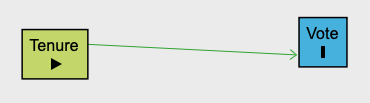
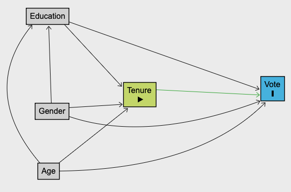

## Introduction

Many social phenomena are discrete or categorical rather than continuous in nature, and such phenomena are often measured by means of a dichotomous or dummy variable - i.e. categorical dependent variables that can only take 2 values. Indeed in sociology and social policy we are much more likely to deal with categorical than continuous variables (poor vs non-poor, in work vs out of work, graduate vs non-graduate, etc.).

For reasons we will discuss below, the assumptions made by the linear regression model - a.k.a. ordinary least-squares regression (OLS) - are not best suited to handle binary outcomes. To analyse a binary dependent variable as a function of multiple independent variables, we need to specify a regression model in such a way that it takes into consideration the nature of binary variables.

This workshop will introduce you to the foundations and application of such type of statistical model: **the logistic regression**

### Data and goals of the analysis

In this workshop we will use a cleaned up selection of variables from the 2005 edition of the British Election Study. The objective of the analysis is to measure how a range of variables affect the probability that an individual voted in the previous general election.

The variables are:

- *vote05*: whether or not the respondent voted;
- *gender*: male vs female
- *tenure*: housing tenure status
- *age*: age in years
- *class*: occupational class
- *education* : education level

Our dependent variable will be **vote05** and we will use the rest of variables to understand or predict **why , based on our knowledge of their individual characteristics, people are more or less likely to vote in general elections**.

### Preliminary steps

We begin by loading libraries:

```{r,  warning=FALSE, message=FALSE}
library(foreign)
library(ggplot2)
library(psych)
library(car)
library(rcompanion)
library(lmtest)
library(sjPlot)
library(sjmisc)
library(sjlabelled)
library(easystats)
options(digits=3) 
```

We begin by loading the data. Notice that the data is in CSV format - this stands for comma separated values and it is a common way to storing data or spreadsheets in a simple text file that can be read in any basic text editor or Excel).

We use the function **read.csv()** to import it into R.

```{r}
bes<-read.csv("bes_qstep.csv",  header=TRUE)
```

A disadvantage of using some CSV files is that the variables are not always labelled. We will then have to define such variables as factors and then assign levels to the variables to make sure the tables are understandable without constantly checking the data dictionary:

```{r,  warning=FALSE, message=FALSE, echo=FALSE, include=FALSE}

# Whether voted in previous general election?
table(bes$vote05)
bes$vote05 <- factor(bes$vote05)
levels(bes$vote05) <- c("Not Voted", "Voted")
table(bes$vote05)

# Gender
table(bes$gender)
bes$gender <- factor(bes$gender)
levels(bes$gender) <- c("Male", "Female")
table(bes$gender)

# Whether owner or renting?
table(bes$tenure)
bes$tenure <- factor(bes$tenure)
levels(bes$tenure) <-c ("Owner","Rental")
table(bes$tenure)

# Occupational class 
table(bes$class) 
bes$class<-as.factor(bes$class)
levels(bes$class)<-c("Professional/HigherTechnical",
                     "Manager/Senior Admin",
                     "Clerical",
                     "Sales/services",
                     "Small business owner",
                     "Foreman/supervisor",
                     "Skilled Manual",
                     "Semi/Unskilled Manual")
table(bes$class) 

#Education level
table(bes$education)
bes$education<-factor(bes$education)
levels(bes$education)<-c("Graduate/PG", "A-level/FE/HE",
                         "GCSE A-C", "Below GCSE A-C")
table(bes$education)
bes$education[bes$education==1]<-"Graduate/PG"
bes$education[bes$education==2]<-"A-level/FE/HE"
bes$education[bes$education==3]<-"GCSE A-C"
bes$education[bes$education==4]<-"Below GCSE A-C"
table(bes$education)

```

Let us quickly look at the distribution of age:

```{r}
describe(bes$age)
hist(bes$age)  
```

## Introducing Logistic Regression

Now that our dataset is ready for analysis, we discuss the logistic regression model. As highlighted earlier, if our dependent variable is categorical and binary, the OLS linear regression model has some issues, so we usually employ a different modelling approach.

There are a number of reasons why OLS regression is inappropriate when using binary DVs, but these reasons are ultimately related to the properties of a variable that can only take two possible values. These reasons can be divided in two types: substantive and statistical

### Substantive reason against OLS for binary DV

We need to think differently about a binary dependent variable than we do about a continuous one. In linear regression we model the expected value of a DV (the mean of Y) conditional on the predictors X. This makes sense because we can calculate the mean of a continuous variable, such as income or number of visits abroad in the past 24 months, and measure how it changes for different levels of a variable or type of respondent.

This would not be the case with a binary variable, because the mean of a binary variable (if coded 0 and 1) is actually a proportion of respondents with a value of 1. For instance, you would calculate the **proportion of people who are employed or probability that a randomly selected individual will be employed**. By definition, proportions and probabilities are bounded by 0 and 1, whereas in theory the mean of a continuous variables can take any value between plus or minus infinity. This is known as the boundary problem, and to understand this it is useful to visualise it.

Let us see what happens when we produce a scatterplot with a binary dependent variable and a continuous independent variable:

```{r, echo=FALSE}
y<-c(0,0,0,0,0,0,1,1,1,1,1,1,1)
x<-c(0,1,2,3,4,5,6,7,8,9,10,11,12)

df<-as.data.frame(cbind(x,y))

ggplot(data=df, aes(x=x, y=y)) + 
  geom_point(shape=1) 

```

As you can see, contrary to the scatterplots you are used to see with two continuous variables, there is no cloud of points but rather two parallel lines of points located at y=0 and y=1.

```{r, echo=FALSE}
ggplot(data=df, aes(x=x, y=y)) + 
  geom_point(shape=1) +
  geom_smooth(method = "lm")  
```

Now, consider a scatterplot with real data: Vote as a DV and Age as a predictor where we overlay a OLS regression line. As you can see the data points are concentrated at 0 and 1 (we have introduced some vertical random noise so that the overlapping points are visible) the scatterplot shows that the dependent variable can only take values 0 and 1.

```{r, echo=FALSE, message=FALSE, warning=FALSE}
bes$votenum<-NA
bes$votenum[bes$vote05=="Not Voted"] <- 0
bes$votenum[bes$vote05=="Voted"] <- 1
  
ggplot(data=bes, aes(x=age, y=votenum)) + 
  geom_point(shape=1,  position = position_jitter(w = 0, h = 0.03)) +
  geom_smooth(method = "lm", fullrange=TRUE ) +  xlim(0,130)

```

The line of best fit minimises the squared differences between the predicted values and the observed values. Notice however that the linear regression can, as age increases beyond the original range, predict values that exceed 1, even when the proportions are bound at 1 as maximum value. This is simply non-sensical!

**So the main substantive reason why OLS is inadequate for binary dependent variables is that the model can predict values that are essentially impossible**. It is important to note here that it is not the binary variable that's the problem, but that the functional form of our model simply does not fit the data well. In other words, the problem is in assuming that a straight line (the linearity assumption in OLS) provides an appropriate representation of a relationship represent the relationship between a binary DV and IV.

### Statistical reasons against OLS for binary DV

There are also more technical reasons why OLS is not appropriate when modelling a binary DV.

The first problem is that the distribution of errors is clearly not Normal. In a linear regression with a continuous dependent variable we assume that the error term (as reflected in the residuals) is normally distributed. This is impossible with a dependent variable because there are only two possible residuals for each value of the independent variable X. This is simply because there are only two possible values (1 and 0) that can deviate from the prediction. Thus:

$$1-\hat{Y}=1-(b_0 + b_1 X_{i}) \quad \text{when} \quad Y_i=1$$

$$0-\hat{Y}=0-(b_0 + b_1 X_{i}) \quad \text{when} \quad Y_i=0$$

The second, more important problem is that the variance of errors will not be constant across different levels of the predictors and/or predicted values - a violation of the homoskedasticity assumption. This becomes clear if you consider the scatterplot we saw early. The residuals (vertical distances between predicted values and observed values) are very small as the line approaches 0 or 1, but anywhere in between the residuals will likely be large (the distance between the points and the line is larger.) This has consequences for the estimation of the standard errors which will be larger and therefore you will artificially need more data to find signicant coefficients.

Summming up, we tend not to use OLS regression with a binary DV because:

- the relation is not linear
- the model will predict values outside of the 0 to 1 range
- the residuals will not be normally distributed
- the variance of the residuals will not be constant across different levels of X.

Be aware, however, that in some disciplines researchers may use the so-called Linear Probability Model, which is essentially a linear regression with a binary dependent variable. Generally, the LPM will produce substantive conclusions about the effects of interest that are roughly the same as the logistic regression, even if it will produce implausible out-of-bound predictions. It is important, thus to consider what is the aim of your research when doing the analysis: are you trying to estimate unbiased causal effects? or are you trying to make predictions?

## From contingency table to logistic regression

To understand what the regression logistic is doing with our data it is useful to start with a very simple contingency table. Imagine we are interested in the relation between voting behaviour and wealth. A fair proxy for weight is housing tenure - i.e. whether the respondent is a property owner or a tenant in rented accomodation. Let us first have a look at the univariate distribution of both variables:

```{r}
#Descriptive stats

##Tables
votetab<-table(bes$vote05)
addmargins(votetab)
prop.table(votetab)

tenuretab<-table(bes$tenure)
addmargins(tenuretab)
prop.table(tenuretab)

```

And now run a contingency table of vote by tenure:

```{r}

tenvote<-table(bes$vote05,bes$tenure)

addmargins(tenvote)

prop.table(tenvote, 2)


```

We can visualise the same information by means of a stacked bar chart:

```{r}
#stacked bar chart
ggplot(data=bes[!is.na(bes$vote05) & !is.na(bes$tenure) , ], 
       aes(x=tenure, fill=vote05)) +
  geom_bar(stat="count", aes(fill=vote05), position="fill")

```

### Running a chi-squared test of association:

As we discussed earlier a chi-squared test is a hypothesis test that measures the strength of evidence against the null hypothesis.

Remember that the Null Hypothesis states that there is no association between two categorical variables or, in other words, that the distribution of one variable is the same regardless of the category of the other variables. In our case, the null hypothesis is as follows:

- There is no association between voting and housing tenure
- The distribution of voters and non-voters will be (broadly) the same across owners and non-owners.

We can use the expected and observed values to calculate the chi-squared statistic ($\chi^2$). Remember that the formula is as follows:

$$\chi^2 = \sum_{i=1}^{k}\frac{(O_i - E_i)^2}{E_i} $$

This means that the chi-squared statistic is equal to the sum of the squared differences between observed counts (data) and expected counts (null hypothesis) divided by the expected counts.

The larger the value of $\chi^2$ the greater the difference between your data and what we should expect to see if there were no relationship between the two variables of interest. The second step in the chi-squared tests addresses the following question: What is the probability that the difference between observed and expected is at least as large as that captured by chi\^2 if the null hypothesis were true?

In R this is quite easy to reproduce:

```{r}
#we run a chi-squared test 
chi_tenvote<-chisq.test(tenvote, correct = FALSE)
chi_tenvote

```

In this case, we find a very small p-value indicating that if the null hypothesis were true, the probability of us observing such a large difference between observed and expected values is very small. We then say that there is a significant association between vote and housing tenure.

### Odds and Odds Ratio

There is a large and statistically significant difference in the distribution of voters and non-voters across tenure status. On average, individuals who own their home are much more likely to vote than those who rent. *But how much more likely are they?*

To answer this question we can use a different way of expressing probabilities: **the odds**. To calculate the odds of an event we divide the probability of an event by the probability that the event won't occur:

$$O_{event} = \frac{P(event)}{1-P(event)}$$

Let's look at the table again:

```{r}
prop.table(tenvote, 2)
```

For instance the odds of a homeowner voting as opposed to not voting are:

$$O_{vote|owner} = \frac{P(vote|owner)}{1-P(vote|owner)}=\frac{0.805}{0.195} = 4.13 $$

And the odds of a tenant voting as opposed to not voting:

$$O_{vote|tenant} = \frac{P(vote|tenant)}{1-P(vote|tenant)}=\frac{0.569}{0.431} = 1.32 $$

Once we have the odds of each event we can compare how likely each event is compared to the other by means of the Odds Ratio (OR) or relative odds which is nothing more than the ratio of two odds. For instance the Odds Ratio of a homeowner voting as opposed to a tenant voting is:

$$OR =  \frac{O_{vote|owner}}{O_{vote|tenant}}=\frac{4.13}{1.32} = 3.12 $$

This indicates that a homeowner is three times more likely to vote than someone who lives in rented accommodation.

### Odds to Logits

You may be now wondering how this relates to logistic regression. It turns out that the logistic regression is in essence a linear regression in which the binary dependent variable has been transformed.

Recall that our main problem is that proportions and probabilities cannot exceed 0 or 1, but that the linear regression line can predict values outside that range. What we need is to be able to get rid of these boundaries by transforming probabilities into so-called **logits**.

- The first step is to transform the probabilities into odds. This allows probabilities to be expressed in such a way that they can take values larger than 1 and up to infinite.

- The second step is to take the natural logarithm of the odds which gets rid of the 0 boundary so that it can take negative values.

The resulting quantities are the logits or log-odds which are essentially a way of representing probabilities in a way that can be treated continuosly.

$$logit =ln(\frac{p}{1-p})$$

Thus we can specify a logistic regression model that looks like this:

$$ln(\frac{p}{1-p})=b_0+b_1Xi $$

## Specifying a binary logistic regression in R

So let us begin by making sure that we have full information on all cases. Otherwise we cannot compare models in any meaningful way. Since we will use all of the variables in the dataset we can specify

```{r}
bes<-bes[complete.cases(bes), ]
```

We specify the first model, which regresses the log-odds of voting on whether the respondent owns the house. The model can be specified formally as an equation:

$$log\bigg(\frac{P(\text{Voted})}{P(\text{Not voted})}\bigg) = b_0 + b1 \text{TENURE}$$

### Fitting a simple logistic regression in R:

The basic syntax for a logistic regression in R is as follows:

$$\text{model1 <- glm(DV ~ IV1 + IV2 + ... + IV, data = dataset, family = "binomial")}$$

Before we run the model and interpret coefficients R will produce, consider the following:

- The table of coefficients produced by R for a logistic regression has many similarities with the linear regression output.

- The dependent variable is the log-odds or logits of an event happening, in our case the transformed probability that a person will have voted conditional on their characteristics as represented by the independent variable.

- The coefficients (or estimates as R names them) are thus indicating the difference in logits - i.e. the difference or change in the logit or log odds of an event happening associated with a 1 unit increase in the independent variable (continuous) or with the comparison of one group against another (categorical).

- There are no $R^2$ statistics. It is possible to produce so-called pseudo-$R^2$ indicators (see later) but they don't have the same meaning.

- There are no F-test statistics of global significance either. We can however compare models against each other and test whether a more complex model provides a significant improvement in model fit.



So the syntax for our first model is:

```{r}
model1 <- glm(vote05 ~ tenure, data = bes, family = "binomial")
summary(model1)

```

Similar to linear regression we pay attention to the *estimates* and the p-values. In this case we find that the coefficient for being in rented accomodation (tenureRental) is -1.24 with a very small associated p-value. This indicates a negative and statistically significant difference in the probability of voting vs not voting for those who rent as opposed to those who own their home.

We can also transform the logit coefficients into odds-ratio (a different way of reporting the logistic regression coefficients) that (for some) may be easier to interpret:

```{r}

exp(cbind(OR=coef(model1), confint(model1)))

```

To understand odds-ratio coefficients here's a brief introduction:

- If the OR are equal to 1 then the probability of experiencing an event is equal for the target group (renters) than for the reference group (voters).

- If the OR are larger than 1 then the probability of experiencing an event is greater for the target group than for the reference group. If OR are equal to 1.5 that means that on average the target group is 50% (or 1.5 times) more likely than the reference group to experience an event. If OR are equal to 3 that means that on average the target group is 3 times more likely than the reference group to experience an event.

- If the OR are smaller than 1 then the probability of experiencing an event is smaller for the target group than for the reference group. If OR are equal to 0.5 that means that on average the target group is 50% less likely than the reference group to experience an event. You could also say that, conversely, the reference group is twice as likely as the target group to experience the event.

So if the OR comparing the probability of voting between renters to owners is 0.29, all you need to do is subtract than from 1 and you'll have the percentage decrease in probability associated with such group:

$$1-0.29=0.71$$ This means that on average the target group is 71% less likely than the reference group to report being worried.

Alternatively, if you find the "% less likely" wording a bit awkward, you could just always invert the odds ratio:

$$1/0.29=3.45$$

Which means that on average owners are 3.45 times more likely than the renters to vote.

### Reporting simple logistic regression:

I have fitted a simple logistic regressio model with "whether or not voted in the General Election" as binary dependent variable and Tenure (owner/renter) as independent variable. The model coefficients show that the log odds of voting are statistically significantly smaller amongst those respondents who rent their homes (b=-1.24, z=-11.8, p\<0.001). Expressing the coefficient as odds-ratio, we find that renters are 71% less likely (CI = 64%, 77%) to report having voted in the previous general election than those who own their homes. This confirms our expectation that voter turnout amongst renters is much lower than amongst owners, thus pointing to a possible association between wealth or socioeconomic status and electoral participation.

### Fitting a multiple logistic regression in R

Now we add a number of control variables(education, age) that may account for why homeowners are more likely to vote. We do this because we suspect that (a) on average, older people are more likely to both own their home and to vote and (b) the more educated are more likely to vote and to own their home (possibly due to having greater disposable incomes).



Again formally this is:

$$log\bigg(\frac{P(\text{Voted})}{P(\text{Not Voted})}\bigg) = b_0 + b1 \text{TENURE} +  b_2 \text{EDUCATION} + b_3 \text{AGE}$$

And in R this is:

```{r}
model2 <- glm(vote05 ~ tenure + education + age, data = bes, family = "binomial")
summary(model2)
```

Again, we pay attention to the coefficients or estimates in the regression table. After controlling for education and age, we find that the coefficient for being in rented accomodation (tenureRental) is -0.87 with a very small associated p-value. In other words, that even if we hold education and age constant, those who are in rented accomodation are significantly less likely to vote than those who own their property. Notice however, that after introducing other independent variables the coefficient for tenureRental has become much smaller. This is simply a reflection that the added predictors partly, but not totally, account for the difference in voting between renters and homeowners.

We can again express this in terms of odds-ratio:

```{r}
exp(cbind(OR=coef(model2), confint(model2)))
```

We find that, holding all other variables constant:

- Those who rent their property are 58% (CI= 47% -76%) less likely to vote than those who own their home.

### Reporting a multiple logistic regression:

I have fitted a multiple logistic regression model with "whether or not voted in the General Election" as binary dependent variable and Tenure (owner/renter), education and age as independent variables. The first thing to notice is that after controlling for education and age the log odds of having voted in the previous general election are still much lower for those who own their home compared to those who rent (b=-0.87, z=-7.62, p\<0.001). Expressing the coefficient as odds-ratio, we find that renters are 58% (CI= 47% -76%) less likely to vote than homeowners holding age and educational qualification constant.

Overall, the results of our model suggest that there is indeed a significant and negative relationship between renting and voting behaviour. This association holds even when controlling for age and education.

### Regression tables

To see model1 and model 2 side by side you can use the following function:

```{r}
# as odd-ratios by default
tab_model(model1, model2) 
```

And can also be expressed as logit coefficients:

```{r}
# as odd-ratios by default
tab_model(model1, model2, transform = NULL, auto.label = FALSE)
```

## Model fit

Now the model fit of logistic regression cannot be evaluated in the same way as OLS. **Neither the F-test of global significance or** $R^2$ are available to us to decide whether our model is any good in absolute terms. There are however a number of options that involve the assessment of relative model fit which are discussed below:

### AIC

As part of the regression output you obtain an indicator called AIC which stands for Akaike's Information Criterion. This indicator allows you to compare models against each other to help you decide which is best. **The lower the AIC value, the better the model fits the data.**

You can either check the regression outputs again or you can retrieve the AICs directly:

```{r}
model1$aic
model2$aic
```

As you can see model 2 (AIC=2413) achieves a lower AIC value than the first model (AIC=2594) so we conclude it provides a better fit to the data. This should not be surprising as the model has more information (in the form of additional variables) and predicts the data more accurately.

### Pseudo-$R^2$

There are also a number of indicators called Pseudo-$R^2$ that try to approximate in logistic regression what the $R^2$ does for linear regression. **These are however not directly comparable to the R-squared for OLS models. Nor can they be interpreted as the proportion of the variability in the dependent variable that is explained by model**. Instead pseudo R-squared measures are **relative measures of fit**, i.e. they compare the fit of one model to that of another model.

The **nagelkerke()** function computes those for you. By default, it compares the fit of the null model (a logistic regression model with your DV but without predictors) to the model of your choice. Let us do this with the first of our models:

```{r}
nagelkerke(model1)
```

The output shows 3 different Pseudo-$R^2$ measures (McFadden, Cox and Snell, Nagelkerke). From those numbers alone, you cannot conclude anything about how well your model fits the data, only that it fits better than a model without predictors. It includes also the log-likelihood ratio test which is significant. This means that our model with one predictor provides a better fit than the model without predictors.

Now, this on its own does not tell you much. It is only by comparing them to the same measures for a model based on exactly the same data and dependent variable (a nested model) that you can learn something. Let's run the same command with our final model:

```{r}
nagelkerke(model2)
```

If we compare the Pseudo-$R^2$ measures from model1 to modelfinal, we find that the latter has higher values. This means that in comparison to the null model (no predictors), the final model achieves better model fit than that achieved by the first model with only one predictor.

### Log-likelihood Ratio Test

We can also make a comparison by testing the null hypothesis that the more complex model is NOT an improvement over the simpler model. If significant we would conclude that the model 2 is an improvement over model 1. It is easy to do this in R using either of the following lines:

```{r}
anova(model1 , model2, test="Chisq") 
lrtest(model1 , model2)
```

The very small p-value suggests that there is a significant improvement in introducing the control variables to our model compared to the first model with only tenure as a predictor.

### Classification rate

Another interesting indication of how well our model fits the data is by estimating the classification rate of our model. This means calculating the percentage of cases that our model predicts should be "worried" and "not worried" about cybercrime and comparing it to the actual data. This is achieved by building a contingency table with the cyber variable on the rows and the predicted values on the columns.

Remember however that the predicted values of the logistic regression will be probabilities rather than 0 or 1s, so we need to trick R into transforming values that exceed the 0.5 probability into 1s. This is achieved as follows:

```{r}
predict <- predict(model2, type = 'response')

accuracy<-table(bes$vote05, predict > 0.5)

accuracy

```

The diagonal of the table captures the cases that have been correctly classified - i.e. Not Worried & FALSE and Worried & TRUE. While the remaining off-diagonal cells are those cases that the model got wrong. As you can see, many the cases have been classified in the wrong category based on our prediction, so it is useful to know exactly what percentage of the cases our model actually got right. We can find the **classification rate** by running the line below which essentially sums the cases in the diagonal, divides them by the total sum of cases and multiplies that by 100:

```{r}
#add the diagonal and divide it by the total
sum(diag(accuracy))/sum(accuracy)*100
```

This tells us that our model correctly classifies around 78% of the observations. This is pretty good considering that we are only working with three predictors - i.e. our model gets just under 22% of the predictions wrong - but yet again we are working with a rather simple and simplistic model. There are many more independent variables we could have included that would make our model fit better and predict our data more accurately!

### What happens if a variable is insignificant?

Suppose we specify another model - model 3 - that includes the additional control variable *gender*:

```{r}
model3 <- glm(vote05 ~ tenure + education + age + gender, data = bes, family = "binomial")
summary(model3)
```

As you can see the coefficient for gender is positive but insignificant (b=0.15, z=1.43, p\<0.8) in other words, we don't have enough evidence to reject the null hypothesis that women and men are equally likely to vote. What do we do when we find a statistically insignificant predictor (especially when it's a control variable).

The short answers is that there is not right or wrong answer as to whether we should keep the variable in the model. It largely depends on the theoretical model you are trying to test. There are however ways to at least evaluate whether the removal of the variable would have a significant effect on the overall model fit.

This involves a model comparison between the last model we fitted model2 and the new model with sex as an additional predictor.

We can compare the AIC:

```{r}
model2$aic
model3$aic
```

Basically the AICs of both models are about the same. Essentially both models are quite similar in terms of model fit so the decision can't be made on that basis - even though we will prefer simpler models whenever possible.

We can also test the null hypothesis that model3 does not improve the model fit of model2 using the log-likelihood ratio test:

```{r}
lrtest(model2 , model3) 
```

Now, the p-value (0.15) is greater than 0.05 which indicates that the model with sex as a predictor is not a significant improvement over the model without sex as a predictor. This would suggest that including the predictor does not make our model better, so we can consider eliminating it unless we have a strong theoretical reason to keep it there.

Finally, we can compare the model coefficients to see whether the removal of predictor sex would significantly change the rest of coefficients. Remember that the coefficient estimates are adjusted for sex differences.

Let us plot the coefficients side by side:

```{r}

tab_model(model2, model3)

```

Basically, the predictor coefficients remain the same. So the decision to exclude or keep the sex predictor is essentially down to your theoretical model. If you decide to remove it would be fine, if you decide to keep it it would be fine too.

**A note of caution**, however, remember that we are dealing with a very simple model with just a few predictors. It could be the case that if you were to introduce another independent variable in this model, suddenly either the variable gender could become significant (due to some indirect correlation amongst the predictors) or its removal could alter the size, sign or significance of the one or more of the rest of coefficients. This is why it would be wise to wait until you pretty much have a final model before deciding whether to throw away insignificant predictors.
