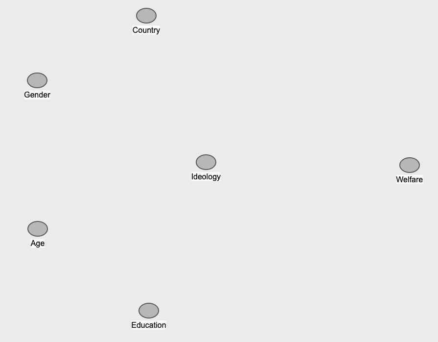
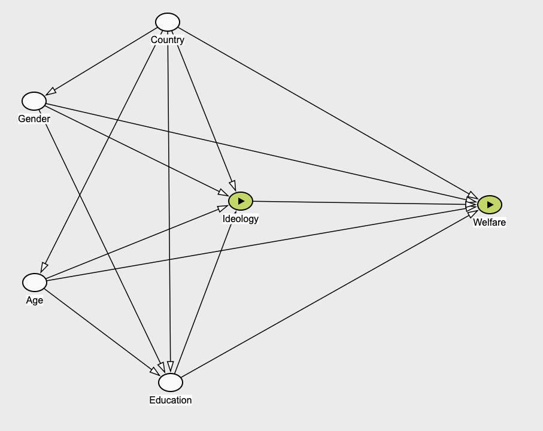
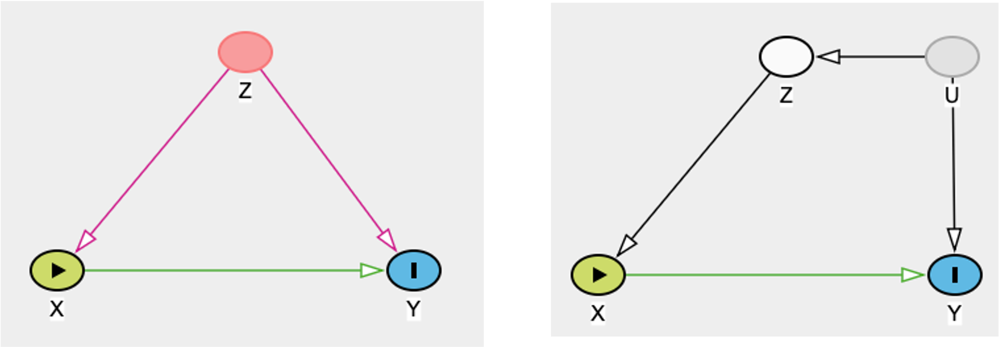
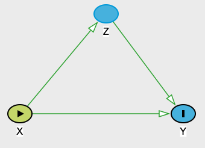

## Introduction

In this workshop we will be looking into how to build a regression model from scratch. We are using the European Social Survey, paying attention to two different dependent variables (one continuous summated scale and one binary) that we will model with linear regression and logistic regression respectively.

These will help you consolidate your understanding of the key issues we need to consider when building regression models for your final assignment or the dissertation project. In that sense, there will be less coding and a greater focus on thinking about data analysis from a substantive and research design point of view. We will pay particular attention to two issues that are fundamental to model building:

- Specifying the estimand.

- Choosing controls.

```{r, message=FALSE, warning=FALSE}
library(tidyverse)
library(psych)
library(ggfortify)
library(MASS)
library(sjstats)
library(sjPlot)
library(jtools)
library(interactions)
library(car)
load("ess_regression.rdata")
```

## What is your estimand?

First and foremost, before you apply a test or specify a regression model, you need to define precisely what is it that you are trying to estimate or measure. This is known as the **theoretical estimand** or quantity of interest, and it is theoretical because it exists outside of the statistical model[@lundberg].

The theoretical estimand involves specifying two distinct but, in your project, interrelated things:

| Unit-specific quantity | Target population |
|------------------------------------|------------------------------------|
| Effect of marriage on women's probability of experiencing domestic violence | Married and cohabiting couples (excludes singles, widowed, divorced...) |
| Effect of living in a former coal area on youth employment chances in Yorkshire | Working age youth in Yorkshire who live in former coal mining areas and those who do not (excludes everyone else) |
| Effect of having children (mitigation) on sentence length | Court sentences involving time to be served (excludes suspended sentences, fines, ...) |
| Effect of probation on re-offending | Those who have been sentenced for offences that are eligible for probation (excludes very serious offences) |

Once you have defined your estimand with sufficient precision the next step is to link it to observable data into an empirical estimand and in turn to an estimation strategy.

## Thinking about controls

Suppose then that our estimand is the e**ffect of ideology on attitudes towards the welfare state** and that we expect that those located more to the left of the political spectrum are more likely to be supportive of and positive about the welfare state.

To make the claim that ideology causes welfare state attitudes we should be able to show evidence that:

1.  There is an association between the assumed cause and effect

2.  The direction flows from cause to effect

3.  Other explanations are ruled out

The third is the key problem we face with observational data, like that derived from surveys. Unlike in an experimental setting, we cannot randomly allocate people into being left wing or right wing and then compare their views on the welfare state and on the basis of that conclude that ideology has a causal effect on welfare attitudes.

Instead, we need a different strategy for ruling out other potential explanations, one that involves conditioning the effect of ideology on welfare attitudes on a range of variables that could be plausible common causes or **confounders** of the association between ideology and welfare attitudes.

Now, consider the following candidate variables shown as nodes in the diagram below, draw the arrows or edges that connect them causally and identify which is the main association of interest and which variables act as controls. Make sure that you provide a theoretical rationale for how you have chosen to connect the nodes one way or another.



You should have come up with something like this:



Conditioning (or controlling, or adjusting) requires an appropriate set of controls. The problem is that **there is not correct number of control variables that you should include in any model**. It should all be derived from substantive knowledge from your research area.

- **Omitted variable bias** is the result of too few controls. This means that you have not been able to rule out that the association is not spurious.

  - Solution: Think carefully about other common causes both observable and unobservable that could be confounding your target association and try to think of ways in which they could be introduce in your model.

- Over-adjustment bias is the result of including too many (and often bad) controls which may well bias your estimates.

  - Solution: Think carefully whether it makes sense to control for a variable based on your substantive knowledge of the problem you are studying

In general you should always adjust or control for confounding variables (either endogenous or exogenous). These are examples of **good controls**



Remember that confounders must precede (or at least be concurrent with) the main predictor and be causally responsible for both the main predictor and the outcome/DV.

**Avoid however controlling for variables that mediate the effect of interest**, as this will tend to introduce a bias in the effect of x on y as it will then be split into a direct and an indirect effect (it will no longer be the total effect).



There are many other types of bad controls, but you will learn more about those in semester 2.

## Building a regression model

### Dataset

The variable **welfare** - a summated scale of welfare related survey items that represents the overall view of respondents on the welfare state. The scale is coded in such a way that the higher the value the more positive the respondent is about the welfare state. The items are as follows:

- SBSTREC - SOCIAL BENEFITS/SERVICES PLACE TOO GREAT STRAIN ON ECONOMY

- SBPRVPV - SOCIAL BENEFITS/SERVICES PREVENT WIDESPREAD POVERTY

- SBEQSOC - SOCIAL BENEFITS/SERVICES LEAD TO A MORE EQUAL SOCIETY

- SBBSNTX - SOCIAL BENEFITS/SERVICES COST BUSINESSES TOO MUCH IN TAXES/CHARGES

- SBLAZY - SOCIAL BENEFITS/SERVICES MAKE PEOPLE LAZY

- SBLWCOA - SOCIAL BENEFITS/SERVICES MAKE PEOPLE LESS WILLING CARE FOR ONE ANOTHER

The second variable we will analyse is a binary variable we will call **sblazy2** which is the result of recoding the original five categories of **sblazy** into two, where the first category is a combination of “Strongly agree”, “Agree” and “Neither” and the second category is a combination of “Disagree” and “Strongly disagree”. The rationale behind this coding decision is that we want to model the probability of having a positive view of the welfare state (as opposed to a neutral or negative one).

We will regress both of those welfare attitudes as dependent variables on the left-right self-placement scales as main predictor. This will take place across two separate models as we have done in past workshops according to the measurement level of the DV.

### Preliminary step: Subset complete cases

**IMPORTANT: You will only be able to do this after you have selected your independent variables. So once you have a model you are satisfied with you need to select complete cases and run the models again**

If regression models are fitted over different datasets, formal and informal comparisons of model fit are strictly speaking not valid. When we fit a model, however, we are only using the cases of respondents who have so-called full information, i.e. individuals who have provided valid answers to ALL the variables included in the model.

In practice by including different independent variables with different patterns of missing data across different models, we end up with models that are based on slightly different datasets. Thus, if we want to meaningfully compare models, we need a dataset that has complete cases for all the variables we are considering.

To do this we use the following command (NOTICE THE COMMA AT THE END!!!) or you could also use drop_na() in tidyverse style.

```{r}
ess_reg <- ess[complete.cases(ess$welfare, ess$lrscale, ess$cntry, ess$grad, ess$agea, ess$gndr) ,]
```

What this line does is create a new dataset called **ess_reg** that includes only those observations that have complete information for every variable we will include in the model.

Now we can proceed to fit the model:

```{r, warning=FALSE}

# INTERACTIONS IN LINEAR REGRESSION

ggplot(data = ess_reg, aes(x = lrscale, y = welfare) ) + 
  geom_point() + geom_smooth(method="lm")

# model2 pro-welf regressed on LR scale
model1 <- lm(welfare ~ lrscale, data = ess_reg)
model1c <- lm(welfare ~ lrscale + cntry + grad + agea + gndr , data = ess_reg)
tab_model(model1, model1c)
plot_summs(model1c)
interact_plot(model1c, pred = "lrscale", modx = "cntry")
```

## Interactions

### What are interaction "effects" and when should we consider using them in a regression model?

So far, we have specified regression models in which predictors are included additively - i.e. the coefficients add or subtract some quantity from the intercept expressed in the metric of the dependent variable. This means that the independent variables in the model are assumed not to interact in predicting the outcome - hence the *ceteris paribus* assumption, whereby the coefficients are interpreted as the difference in the DV associated with one unit increase or a change of category in the IV when all other variables are held to be constant.

An important implication of this is that the slope coefficient for any given independent variable is assumed to be equal across the levels the control variables. For instance, if we regress pay on sex and years spent in education we are implying that the differences in pay associated with sex are constant across all ages, or conversely that the association between pay and age is the same for men and women.

This may not be a tenable assumption in many circumstances. Indeed, when independent variables have large main effects, it is highly likely that they will interact to some extent. For instance, since the gender pay gap has a crucial life course component related (though not exclusively) to child rearing and also that, historically, the pay gap has narrowed over time, it seems implausible that the difference in average pay between women and men in their 50s is the same as that for those in their 30s. In other words, we suspect that the association between pay and gender will vary over age groups. These kinds of questions are those that we can assess by specifying interaction terms in our regression models.

Interaction terms are also called multiplicative terms because they are introduced in the regression model as the product of the two variables that are hypothesised to interact in order to produce a significant difference in the expected value of the dependent variable. Interaction terms can be the product of any combination of two or more variables regardless of their measurement level, as shown in the following examples

- Categorical x Categorical:

  - Pay \~ Unionised x Economic sector: We know that unionised workers have on average higher pay than non-unionised workers, but does this pay premium vary across public and private sector workers?
  - Part-time \~ Gender x Graduate: We know that women are much more likely to work part-time than men, but is the gap in working hours the same for graduate and non-graduates?

- Continuous x Categorical:

  - Attitudes \~ Age x Urban: We know that as people get older they are more likely to oppose same-sex marriage, but is this pattern the same in rural and urban areas?
  - Vote \~ Income x Country : We know that, on average, higher earners are more likely to vote conservative political parties. Is this association the same in the UK than in Sweden or Spain?

- Continuous x Continuous:

  - Wellbeing \~ Income x local area deprivation: We know that on average people with higher incomes tend to enjoy greater psychological wellbeing, but is that association affected by the level of deprivation in one's local environment?
  - Inequality \~ Union density x Leftist Parties vote share: We know that across countries inequality is negatively associated with union density (union membership rates) as their demands often benefit those who get paid less. We may want to know whether this association is unaffected by whether governments are more or less left wing

All these examples suggest that a particular association amongst two variables of interest, represented by its slope coefficient, is also affected or *moderated* by a third variable. The key to understanding this in a regression context, is that while **main effect coefficients add or subtract from the intercept, interaction effects add or subtract from the slope main effect coefficients of each of the interacting variables**.Substantively, this means that interaction effects, if significantly different from 0, modify in some way the slope - either by increasing or decreasing its slope gradient or expected difference. If the interaction effect is insignificant, then we can infer that the difference

Some advice:

- Specify interaction effects when you have a sound substantive social scientific reason to do so.
- Always introduce *both* main effects as well as the interaction term (for the time being anyway and unless you have a good reason not to)
- Make sure you have large sample sizes for the dataset as a whole and also for the groups you are comparing (otherwise you may conclude insignificant results even though the "true" effect is significant).
- Some textbooks advise that there is not much point in interacting variables whose main effect coefficients are insignificant or very small on their own. This is however questionable from a causal inference perspective, so take that advice with a pinch of salt and use your substantive judgment.
- Unless you center or standardise your predictors (we do not cover this in this module), do not interpret the main effects of the predictors that you have allowed to interact as their interpretation will be affected by the assumption that the interaction is held constant.

### Interaction effects in linear regression

After interpreting the regression coefficients, you will have noticed that being on the right of ideological spectrum seems associated with less positive views of the welfare state. You may well suspect, given what we know about cross-national states arrangements that this association may vary across countries (amongst other things because respondents in different countries are being asked to express their views on welfare states that are different). To test that hypothesis as part of the regression we can introduce an interaction term which is the equivalent of multiplying two independent variables together.

In R this is expressed by including a new predictor called **lrscale:cntry** which will measure how the differences in welfare attitudes across the ideological spectrum vary depending on the country of residence. The interaction effect can, however, also be interpreted as the extent to which the average differences in attitudes between countries vary depending on the respondent's ideology. **Remember, interaction terms are symmetrical, it's our substantive interpretation that gives them a particular meaning in terms of causal direction.**

Here's the same model as before, now with the interaction term:

```{r}
model_int <- lm(welfare ~ lrscale + cntry + grad + agea + gndr + lrscale:cntry , data = ess_reg)
tab_model(model1, model1c, model_int)
plot_summs(model_int)
interact_plot(model_int, pred = "lrscale", modx = "cntry",
              x.label = "Left-Right Scale", 
              y.label = "Pro-welfare attitudes",
              main.title = "Model 3: Welfare attitudes and ideology across countries",  
              legend.main = "Country") 
```

Now we could do the same for education x country

```{r}

model_int2<- lm(welfare ~ lrscale + cntry + grad + agea + gndr + grad:cntry , data = ess_reg)
plot_summs(model_int2)
cat_plot(model_int2, pred = "cntry", modx = "grad",
              x.label = "Educational qualifications", 
              y.label = "Pro-welfare attitudes",
              main.title = "Model 3: Welfare attitudes and education across countries",  
              legend.main = "Country") 

```

### Interactions in logistic regression

We can also specific interaction terms within a logistic regression model. **Suppose that instead of being interested in examining the effect of ideology in broader welfare attitudes, our model is instead focused on the effect of ideology on the probability that respondents believe that social benefits makes people lazy**, and by analogy to our first batch of models, we have substantive reasons to believe that these differences may vary depending on country. Since this is a binary outcome, we will opt for a binary logistic regression.

```{r}


# Model 4: WS makes people lazy regressed on LR scale + other

table(ess$sblazy2)

# Model without interactions
model4a <- glm(sblazy2 ~ lrscale + cntry + grad + agea + gndr,
              data = ess, family="binomial")

# Model 4b: WS makes people lazy regressed on LR scale + LR: cntry interaction
model4b <- glm(sblazy2 ~ lrscale + cntry + grad + agea + gndr + lrscale:cntry ,
              data = ess, family="binomial")

#Model 4c: WS makes people lazy regressed on grad + grad: cntry interaction
model4c <- glm(sblazy2 ~ grad + lrscale + cntry + grad + agea + gndr + grad:cntry ,
              data = ess, family="binomial")

tab_model(model4a, model4b, model4c)

effect_plot(model4a, pred = "lrscale") 
interact_plot(model4b, pred = "lrscale", modx = "cntry") 
cat_plot(model4c, pred = "cntry", modx =  "grad")


```
