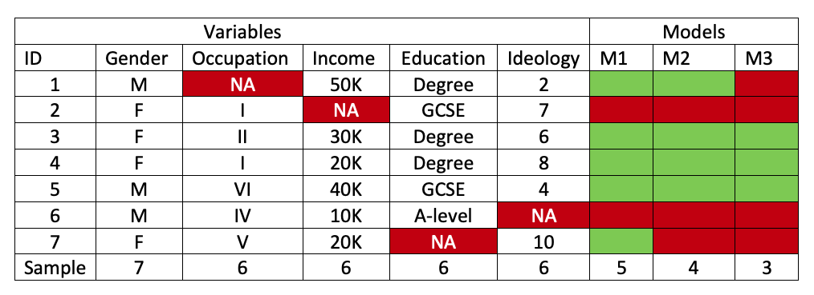
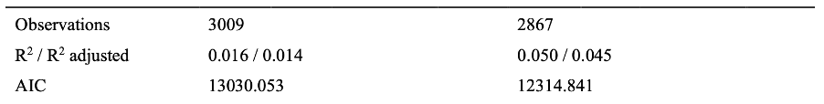
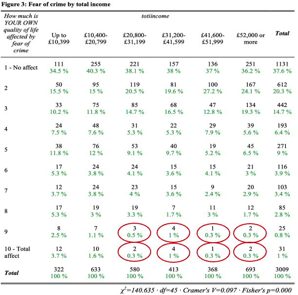
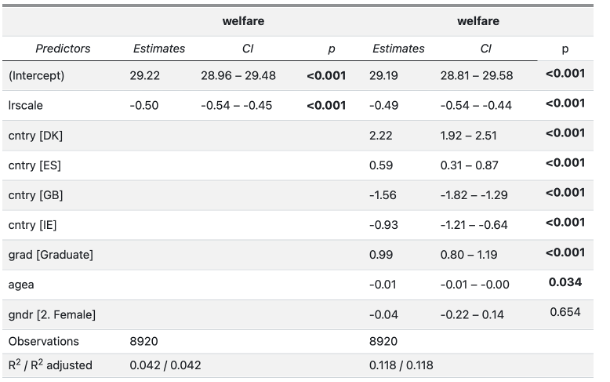
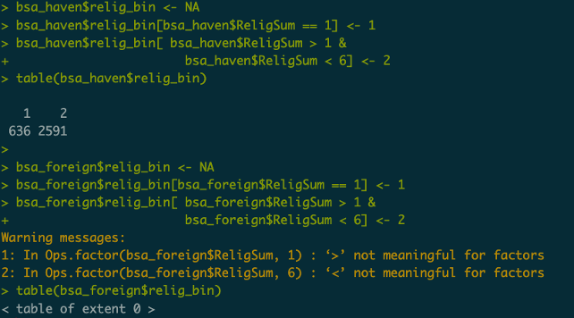

# Practical issues for the assessment (and beyond) {.unnumbered}

## Introduction

This chapter addresses a range of issues and questions that are relevant to the assessment and that have come up in class discussions, open door conversations and email exchanges we have had with students over the years.

The first section outlines the key practical steps involved in conducting the research project and advice on the main issues to consider when undertaking it.

The second section is focused on common problems that can be experienced when conducting a quantitative social research project. It is divided into two sections, the first focused on analytical issues and the second that's concerned with substantive coherence and writing technique.

# Analytical steps {#sec-practical-data-analysis-steps}

The analysis leading to this report should be based on the material we have covered in the module workshops and guides. Here is an overview of the main steps you should follow while conducting your research.

## Specifying research questions 

As discussed in Unit 7, having a clearly defined research question and a precisely delimited estimand is crucial to ensure that your research design can *a priori* produce the findings that could plausibly address the questions that motivated the study. In this sense, it's important to **focus on a specific association of interest** - e.g. what is the effect of X on Y or what is the difference in Y between the different categories of X - and **avoid open-ended research questions about the determinants or causes of Y** that do not imply a clear estimand.

The specification of the research question raises an important problem in applied research, especially at this level. A standard textbook-like model of research proposes a linear sequence where the research question and estimand are fixed throughout the project. Bear in mind, however, that partly because this is one of your first research projects and also the fact that you will be relying on secondary data, there will inevitably be some back and forth between your research questions and your analysis.

It's in this sense plausible that after fitting your first descriptive analysis and modesl you may well come up with new ideas from readings and your own thinking that can inform further model revisions and improvements (e.g. adding other independent variables or an interaction). Thus, your experience of conducting your research project may not resemble that linear textbook account, and this is not necessarily a problem.

That being said, I **would strongly advise you NOT to alter your research questions or hypotheses after looking at the data if you find insignificant results or results that do not fit your expectations** and then re-running your analysis - i.e. double-dipping, p-hacking, or going on a fishing expedition - until you get the results you like or wanted.

Remember that the main objective is, ultimately, to assess the weight of evidence in favour or against a particular explanation of how a very narrow part of the social world works and therefore to learn about it. It is not about our theories or pre-existing beliefs being “right” or us getting significant results. Remember that  “if you torture the data long enough, it will eventually confess”.

## Choosing your data:

Based on your research question and reading conduct a **data search** in the UK Data service to find an appropriate dataset. If you want to use another relevant dataset that is not available in the UKDS, like the European Social Survey, that’s fine too.

Whenever possible try to use the **most recent data** if you are dealing with repeated cross-sectional surveys, like CSEW or BSA. If your dataset is quite dated but you have not found any better alternative to answer your research question (and explain as much in the methodology, including the disadvantage of using old datasets) you will not be penalised in any way.

If you are merging datasets for different time points because you want to capture changes in associations over time or maybe enhance your sample, **make sure that the choice of time waves reflects your research design and questions.**

**Read the dataset user’s guide and data dictionary** to learn more about where your data comes from, what variables that are available and what questions are behind them, the coding of variables, the sampling method, etc. This is absolutely necessary to be able to write up the methodology section.

## Choosing Variables:

Now, based on your reading of substantive literature and your research questions you need to select:

- A dependent variable that best captures the phenomenon you are trying to study, ,

- The independent variable whose effect on, or group differences in, the dependent variable you want to measure;

- The variables you want to adjust the differences or effects for, including any variables you want to use as part of an interaction effect, if applicable.

The number of control variables you should include in your model will depend on your choice of research question. This is why it is so important to outline in your literature review the different relevant factors that are associated with the dependent variables so that your regression model can mirror the theoretical model. In this sense, drawing your own DAG can help clarify your choice of independent variables.

## Preparing your data 

Now, load the data into R and begin exploring your variables to make sure they are categorised or measured as close as possible to what you require in your analysis.  This involves:

- defining missing values

- recoding categorical variables

- categorising continuous variable

- trimming or capping the values of continuous variables

- merging datasets

- summating or averaging of several Likert items to form a scale

- re-ordering categories

- Any other necessary data manipulation technique.

### Univariate analysis

Describe the univariate distribution of the dependent variable and main predictor variable.

- Counts and percentages if categorical

- Mean, standard deviation, 95% confidence interval, median, min, max and IQR

Produce an appropriate plot of the dependent variable AND main predictor (and if applicable a third variable interacting with the predictor). **These must be displayed and described clearly in the main body of the report.**

- If continuous use a boxplot, histogram or density plot

- If categorical use a bar chart (pie charts are forbidden by law)

**Include tables for the univariate distribution of all other variables in the appendices**. You do not need to produce plots for those or describe them in the main body. Simply signpost in the main body where in the appendices the tables are, unless there is something of substantive interest in their distribution in which case briefly mention it.

### Bivariate analysis

Conduct bivariate analysis of the data as the first step to address your research question. 

This should involve:

- An analysis of how the dependent variable varies across each of the independent variables, with special emphasis on the association between the dependent variable and the main predictor;

- An analysis of how the main predictor is associated with the control variables.

In practice this involves using a combination of:

- Comparison of group means, t-tests and using multiple boxplots or density **plots if the dependent variable is continuous and the predictors are categorical**;

- Scatterplots and correlation coefficients if **both variables are continuous**;

- Crosstabs, stacked/cluster bar charts and chi-squared tests if **both variables are categorical**.

- In case that you have a **categorical dependent variable and a continuous independent variable** it is a lot trickier because it largely depends on how large the range of the continuous variable is. The easiest option is to break the continuous variable on the basis of some percentile (in quintiles or deciles for instance) and then run a crosstab and a stacked or clustered bar chart based on the new variable to see how the categorical dependent variable varies across different discrete levels of the predictor. Alternatively, you can run a simple logistic regression and then plot the predicted probabilities.

In any case:

- Produce an appropriate bivariate plot and table of the association between the dependent variable AND main predictor. **This must be displayed and described clearly in the main body of the report (including bivariate tests).**

- **Include the bivariate distribution of all other variables with the dependent variable and with the main predictor (including bivariate tests) in the appendices**.  You do not need to produce plots for those. Do however, briefly report in the main body the nature of those associations. This will be also useful to justify the inclusion of variables in the regression model.

### Modelling

Once you have decided your theoretical model you need to specify a regression model that includes the key independent variables that play a role in confounding the association between your main independent and dependent variables:

Remember that if the DV…

- is **continuous use linear/OLS regression**

- **is categorical use logistic regression** – This may involve dichotomising variables with more than 2 categories, which has to be appropriately justified.

In the **main body of the report** you need to present the following models:

- the model with the dependent variable and the main predictor only;

- the model with the dependent variable, the main predictor and the control variables;

- and, if you are specifying a model with interactions, also the model with the dependent variable, the main predictor, the control variables and the interaction “effect” between the predictor and the moderator.

For all models presented you must interpret and discuss the **regression coefficients for the main association of interest (and interactions if applicable) and model fit statistics, including tests comparing model fit**. For the **final model without interactions** on which your main findings rely, you also need to report **regression diagnostics** (multicollinearity, heteroskedasticity, linearity, normality of residuals, …) as applicable to the type of model you are using. The workshop guides provide detailed instructions on how to do this and how to interpret them. You are however not expected to re-specify models to address any violations (you will learn about this in QSR II).

**If you are using automatically formatted tables and plots to display model coefficients, or plot for predicted values in order to assist presentation and interpretation, then also include the full regression output from R in the appendices.**

**Also include in the appendices any other models you estimated but decided against but think it’s worth highlighting for a statistical or substantive reason** (e.g. a control variable you specified based on theory but which turned up to be insignificant and you decided to leave it out – again not something you should do necessarily).

In practice it is likely that you will fit many models with different combinations of control variables (some may perhaps not be significant or may correlate too highly with the other variables - multicollinearity). Here you need to use measures of model fit, model diagnostics and your own judgment based on the knowledge about the literature to decide on what the best model is.

You are **strongly advised against choosing your variables using step-wise regression algorithms** or on the basis of whether or not the effects are significant.

Ultimately, there is no magic number of predictors you should include. It all comes down to how well your regression model mimics the theoretical model. For instance, if I say that the relation between occupation and pay also depends on age, sex, ethnicity and education level (a bit simplistic) then there should be variables for all of those factors. So, think first about what it is important about the social phenomenon you are studying (pay disparity, exposure to poverty, experience of violence, more or less favourable views of unemployment benefits, etc.), think and read about the mechanisms by which some people vary in such measures, and then build a regression model that represents how that mechanism works (i.e. choose the variables that must be part of the explanation).

Remember that all models are wrong, but some are useful. The key to a good analysis and report is how well you can justify that your model is good enough to help you answer (if tentatively) your research question.

# [Hic sunt dracones](https://en.wikipedia.org/wiki/Here_be_dragons) {target="_blank"}

While the structure and expectations of this assignment are clear, this is a real world research-based assignment using real data in real conditions. This means there is still plenty of room for things to go wrong that will affect to varying extent the quality of your written assignment and thus the mark you receive. In this section I introduce a list of issues that you should watch out for so you can recognise when they occur and be able to find a way around them.

## Analytical issues {#sec-analytical-issues}

### Fitting and comparing models based on different sample sizes

Regression models only include **those observations that have valid values across all variables (dependent and independent) in your model specification**. This has important implications for model interpretation and comparison.

Let’s illustrate this problem with an example. Suppose you want to fit the following regression models to a dataset:

- M1 \<- lm(Ideology \~ Income, data = dataset)

-  M2 \<- lm(Ideology \~ Income + educ + gender, data = dataset)

- M3 \<- lm(Ideology \~ Income + educ + occup + gender, data = dataset)

Now, consider the following dataset where NA indicates a missing value. Due to the fact that each variable has its own unique missing data pattern and that each model requiring a different combination of variables, the effective dataset used for each model is not the same across models.

{fig-align="center"}

This is a very common problem that renders model comparison invalid because you are essentially comparing how different models fit different datasets! The good news is that it is easy to spot if you read your regression tables carefully as shown below:

{fig-align="center"}

To avoid this, remember to fit your regression models in a dataset that only contains those observations without any missing values across the dependent and independent variables that you will include in the model specification. You can use functions like `complete.cases()` or `drop_na()` for all the variables included in the final model to achieve that as demonstrated in previous workshops.

### Sparseness

Sparseness refers to the presence of zero or low counts in the values of a variable or for a given combination of values across two or more variables in your data. Note that this is not a problem in and of itself, it is just how the distribution of variables pans out in the real world. It is not implausible that some combinations of values that are theoretically possible are simply rare or even not realised in practice. Consider the table below where the severe skew of the variable in the rows lead to very low counts in some of the cells when cross-classified over a second variable.

{fig-align="center"}

As you can see, there are 8 cells where the count is tiny . This is, to be clear, not a problem with the data but it can lead to problems when estimating quantities of interest from your data because the model has very little information to work with, thus the estimates will be much more uncertain,  i.e. they will have much wider confidence intervals. Importantly**, it also makes it quite hard to interpret the table. For instance, the** $\chi^2$ test will not be appropriate for tables where the expected cell counts are small[@haberman].

In the context of regression, this can be a problem when estimating coefficients (even more so for interaction effects) for specific categories or combination of categories with low counts in the data **because the standard error will be large and therefore it will be less likely to find statistical significance even when the effect size is large**. When this happens you can recode the relevant variables into a narrower range of categories, but be mindful that this can effectively change the substantive or practical meaning of the variable and can render some comparisons impossible. For a classic example, consider that merging detailed ethnic groups (e.g. British Pakistani, British Indian, British Bangladeshi, etc) into an aggregate ethnic group (British Asian) may allow for greater samples that are useful to compare against other aggregate ethnic groups (White British or Black British) but it will obliterate the often large differences existing within each of the aggregate ethnic categories.

### Complete separation and non-convergence

Related to the problem of sparseness is that of complete separation. For those using logistic regression, you may encounter that problem when your binary dependent variable is a) highly skewed due to the fact that one of the categories is very rare and/or b) has a zero or very small sample size for some cells when cross-classified with another variable due to the independent variables perfectly predicting one of the outcomes.

Here's an example. Suppose that you have 100 new graduates applying for a highly selective postgraduate course, that half of the students have high marks from their undergrad degree and the other half have low marks, and that the course selects students on previous academic results. Once the admissions process is finalised, the outcome can be represented as a contingency table:

|            | Admission | No admission |
|------------|:---------:|:------------:|
| High Marks | 30 (30%)  |   20 (20%)   |
| Low Marks  |  0 (0%)   |   50 (50%)   |

: Zero cell count in a contingency table of previous academic performance and admission status

Note that here, having achieved low marks perfectly predicts no admission – i.e if the student got low marks it is impossible for them to get a place in that course. Now, to understand why this is a problem for a logistic regression see what happens when you try to calculate the odds ratio of admission for a student with high marks relative to that of a student with low marks:

$$
text{OR} = \frac{\text{Odds of admission}_{\text{high marks}}}{\text{Odds of admission}_{\text{low marks}}} = \frac{\frac{0.3}{0.2}}{\frac{0}{0.5}} = \frac{1.5}{0} = \infty
$$

Essentially, the **odds ratio are undefined**. In the context of logistic regression this will show up in your tables as **implausibly large coefficients AND standard errors** which is indicative that the model estimation could not converge into a stable solution. You can think of this as a specific case of the more general issue of sparse tables where the model essentially has not enough information in a cell to estimate the coefficient with any precision.

When this occurs there are a [number of options](http://people.vcu.edu/~dbandyop/BIOS625/Convergence_Logistic.pdf), but for the assignment the more straightforward is to recategorize the dependent and/or the independent variable such that the separation problem can be bypassed. This is however not possible when the variable is strictly binary so you may need to choose a different DV to work with.

### The race of the variables

In a classic political methodology paper, @king1986 describes, amongst many others, two important problems in statistical reporting that are very commonly seen in both assignments as well as published work. The first problem **involves comparing regression coefficients for different variables in order to check which variable has a larger effect**. For instance, if from the table below you compared the coefficient for *lrscale* (b = -.50) and *agea* (b = -.04) you could be tempted to conclude that ideology has a larger effect than age on welfare attitudes:

{fig-align="center"}

This makes little sense because the comparison involves interpreting the change in the DV associated with an increase in one unit in two variables measured in different units of measurement (age in years and ideology in an arbitrary 0-10 scale). Even when such regression coefficients are standardised in the form of beta-coefficients (by dividing them by their standard deviation) the substantive meaning of the difference in coefficients remains elusive. Thus, in general, **'only when explanatory variables are on meaningfully common units of measurement is there a chance of comparison’ \[**@king1986, p. 670\]. Additionally, remember that our models are mostly concerned with identifying some specific effect of interest (in this case the effect of ideology on welfare attitudes) and the control variables are included to adjust for confounders so the comparison does not have any substantive value in and of itself.

The second problem raised by King concerns the $R^2$ statistic as a measure of model fit. In the linear regression workshop we discussed that the $R^2$statistic captures the share of the overall variance in the dependent variable that is accounted by the combination of independent variables included in the model. By adding more predictors to your model – in essence by adding information - your predictions will get more and more accurate and therefore your $R^2$ statistic will become larger. The problem King points to in the article is **when we treat the** $R^2$ **statistic as a quantity to maximise for its own sake and at any cost** rather than just as another bit of information about how our model fits the data. If we do this we may be tempted to increase the number of independent variables just for the sake of getting a higher value, but in doing so we may risk **losing control of our control variables**, such that the effect we are really after can become biased by over-adjustment and/or uninterpretable because it no longer seems plausible to say that this is the effect of x on y holding a whole raft of variables constant whose role in the model we no longer understand.

### The table 2 fallacy

A problem identified and labelled by [@westreich2013] and described really well for a social science audience by [@keele2020] is known as the **table 2 fallacy**. This involves the causal interpretation of the estimated associations for control variables, often to check that the direction and statistical significance of the coefficients for the control variables are broadly in line with existing literature. Indeed, it is not uncommon to see researchers interpret unexpected signs or magnitudes of coefficients as perhaps indicative of problems in the data or the model.

What these authors show is that this is definitely not a good practice because, all else being equal, each effect of interest should be estimated with different models underpinned by different causal assumptions or mechanisms.  Suppose you have a model like this:

If your objective is to estimate the effect of part-time work on pay $b_1$ then this model is appropriate because you are controlling for Sex and Age which are plausible confounders or common causes of both part-time work and pay. It is however not warranted to interpret the coefficient $b_2$ as an estimate of the causal effect of Sex on Pay because you’d be implicitly adjusting for part-time status which is not a confounder (part-time status cannot cause sex!) but rather a mediator so $b_2$ would only be capturing the direct effect of sex on pay but not the indirect effect of sex that is mediated through part-time status.

Two implications from this:

- There are no all-purpose models to address multiple research questions in one go. In other wors, each effect or quantity of interest requires a distinctly specified model.

- Do not draw or report causal interpretations of the regression coefficients of the control variables in your model, at best they are meaningless at worst they can mislead you.

### Importing data using *haven* or *foreign* has different implications

In the workshops we have often used datasets that are native to SPSS (extension \*. sav) or Stata (\*. sav), and these are likely the formats that you will encounter when downloading datasets from data repositories such as the UK Data Archive. To use them in R you cannot just use the function `load()` for native R files ( extensions \*. rdata, or \*.rda) but you will instead need to use an appropriate function from either the `haven`or `foreign` packages.

Be aware that there are differences in how each of those packages processes the data which can in turn have consequences in how you need to work with the variables. Indeed, a recurrent issue is that code written to work with data imported with haven may break when running it on the same dataset imported with foreign (and vice-versa).

A key difference, amongst others, and which tends to induce many a headache is how haven and foreign handle **labelled variables**, which are extremely common in survey datasets like those with which we have worked during the workshops.  Labelled variables are a class of variable that contain numeric values as well as text labels that are associated with each of those values – for instance 1 may be “Employed” and 2 “Unemployed”. The key difference between haven and foreign is that *foreign* automatically converts labelled variables into factors (how R treats categorical variables with values and levels) whereas *haven* stores them as a class called haven_labelled which is slightly different and more tidyverse-friendly.

This difference can be seen in the screenshot below where the same BSA 2013 dataset is imported using both foreign and haven:

{fig-align="center"}

Apart from the fact that the resulting class (type of object) for the same variable and dataset is different across different packages, the way that base R functions like table() process the data is also different. Thus, when using foreign to import data, a frequency table of the religion variable will show the levels (category labels) rather than the values, whereas when using haven to import the same dataset the frequency table will show only the category values but not the labels. Indeed, we will need to transform it into a factor to get the labels to show up. If, however, you were to use tidyverse syntax the labels would then show too, as in the screenshot below, without having to declare that variable as a factor:

{fig-align="center"}

These differences do not just have consequences for analysis, they also pose issues when undertaking data manipulation work as shown below when trying to create a new variable that collapses religious identity in just two categories “Church of England” vs “Other”:

{fig-align="center"}

Notice that by not transforming the variable into a factor, haven imports the data in such a way that R can recognise the categories by their numeric values so operators like “greater than” or “smaller than” can work. In contrast, when the variable is forced by foreign to become a factor, R will no longer recognise the numerical values and will only accept the levels or text labels associated with the values. 

The lesson here is that different packages (and not only those used to import non-native datasets) will handle data in different ways and it is crucial that you understand how each package does it so that you know how to work with it.

### Interactions and intervening variables

In the module we have discussed many times the issue of good and bad controls and how, in principle, **we should avoid controlling for variables that lie in the path between our main predictor and our dependent variable**. This is so because by controlling for intervening variables we basically split the total effect of interest between its direct component (x -\> y) and its indirect component (x -\> z -\> y) and therefore the interpretation of the coefficient needs to be interpreted differently to avoid incurring in post-treatment bias. In a previous section we have referred to whether controlling for part-time status is warranted when examining the effect of gender on pay.

This, however, does not mean that you cannot estimate regression models with interaction effect between gender and part-time on pay. This is because of two things: a) the question (or estimand) that is answered (estimated) by the inclusion of an interaction effect is no longer a question about the main effect of sex, but about how women and men’s pay differ in part-time compared to full-time work; and b) because interactions are fundamentally symmetrical and in a way are agnostic as to the causal direction. Thus the interaction effect under consideration can be understood as measuring how the gender pay gap varies by employment contract, but also how the differences in pay between employment contracts vary by gender.

The key idea here is that different kinds of questions require different kinds of models and that before you decide whether a candidate variable for inclusion as a control is “good” or “bad” or whether an interaction is needed or not, the first thing to consider is what is it that you are after.

### Otherwise “correct” code that will nonetheless break

Sometimes code that seems to work ok, suddenly out of the blue stops working and no matter how much you check for inactive packages, unclosed brackets, missing commas, misplaced operators or misspelled variable names R will keep throwing errors at you or it will produce the wrong objects or output.

Such situations can send even the most confident analyst into bouts of profound despair and existential angst, so here are some tips on what to do:

- Do not despair and/or panic.

- Take a break from the screen and ideally go for a walk to clear your head.

- Reboot R or start a fresh R session (via Menu \> Session \> Restart R or pressing Shift-Cmd-F10 or Shift-Ctrl-F10).

- Run your code slowly one line at a time and look carefully at the console to check for errors, warnings or messages and to check that the output looks ok (yes, that may take a while).

Assuming there are no typographical errors, two issues that are quite common are:

**Dependencies between different parts of your script**. When you are working with a very long script or across separate scripts for different parts of your analysis (e.g. one script for data wrangling, another script for models, etc) there is a risk of losing track of the dependencies between the different steps in your analysis. For example, if after running a regression you figure out you need another variable that you perhaps need to recode, then you need to consider the implications this will have for the rest of the analysis such as the missing cases in the new variable for your effective sample size. In general, if you make a change to your data (e.g. renaming a variable or a dataset, change the subsetting criteria, etc ) you need to check all your code to make sure the new change is reflected the rest of analysis and obviously re-run all the code.

**Conflicts or incompatibilities between packages.** It happens occasionally that functions from different packages have the exact same name so that when you load them R needs to decide what to do with the conflict. What R does is to use the function for the package that was called last as shown here:

In this case, the `select()` function from `MASS` (because it was called second, after `tidyverse`) will be the one that R chooses in case of conflict. R tells you that the function `select()` from `dplyr` (within the `tidyverse` package suite) is masked, that is, it will not be used.

The solution to this is to load them in such order that the function you actually need is not masked by the other package. A perhaps better alternative is to call one of the libraries whose functions you actually need - as usual with `library(package)` **-** and then, instead of loading a second library that you know will be in conflict with the first, use the expression `package::function()`to use a function from the second package without needing to call it.

For these and many other common troubleshooting issues, you can find more information [here](https://bookdown.org/pdr_higgins/rmrwr/interpreting-error-messages.html#the-common-errors-table),[ here](https://bookdown.org/yih_huynh/Guide-to-R-Book/trouble.html) and [here](https://jtr13.github.io/cc21/common-errors-in-r.html).

## Substantive and writing issues  {#sec-substantive-and-writing-issues-}

Finally, here’s a brief outline of some substantive and writing issues that you ought to bear in mind when working on your assignments.

### Mismatch between concept and measurement

Sometimes the dependent variable used in the analysis does not match well the concept at the heart of your research question. For instance, one may say they are studying fear of crime in the question but then they use a variable that capture *how much quality of life is affected by fear of crime*.

Obviously, variables are necessarily simplified representations of reality, and no variable will capture perfectly the underlying concept you are trying to study but you should still aim to get as close as possible. If you cannot then explain what drove you to choose that variable instead and tell us what are the implications are for your study and for your results and contribution to existing knowledge on your topic of interest. This can be part of your discussion of the limitations.

### Mismatch between question and literature

To inform your research question, design and subsequent data analysis you will need to draw on existing published research that deals with different aspects of your phenomena of interest.

Here, especially because of the limited wordcount, it is important to delimit what is important and what is related but not important. You should aim to be narrow in delimiting the study and to review literature that is focused on the specific estimand defined for a particular unit of analysis and a specific population of interest.  Try, in this sense, not to waste words on material that only serves as background information.

Also think carefully about the context in which mechanism you are trying to grapple with operates. It is not the same to understand the differences in political behaviour of Catholics and Protestants in England than it is to do so in Northern Ireland, so make sure that your reading, thinking and writing reflects that context. In that sense, especially if the literature about this topic is underdeveloped in your chosen context, by all means draw from international evidence to frame a problem, draw ideas and concepts or borrow methods, but be careful not to assume that these will “travel” well.

### Interpretation of results

Make the most of your tables and report all the quantities of interest. For instance, if you have more than two categories in your main predictor  do not focus on only comparing – e.g. like the differences in the DV between extremes of the distribution, instead of examining the differences amongst the middle categories.

Remember that insignificant results are informative of something, whether or not they agree with your theoretical expectations. Finding insignificant results is NOT a problem in and of itself, it’s simply an indication that your model is not able to conclude whether the effect under consideration is positive or negative. This can be because the effect is so small that is nearly zero or because you cannot estimate it with sufficient precision (standard errors are large relative to the coefficient value) generally due to small sample size or model specification problems. Either way, it is a finding and can be discussed in relation to your literature derived expectations.

Be very precise in how you report your findings.

Interpret your findings, do not just report them. Tell us not just what your findings are  but also what they mean. Remember that, after all, you are a social scientist doing research on sociology, social policy, criminology, political science topics to answer substantively meaningful questions in your field of study. This needs to be very prominent in your assignment. Without domain knowledge and expertise backing your research design and analytical choices, all these numbers mean very little.

### Writing issues

Try to present data as clearly and tidily as possible. Make sure that tables and graphs are correctly titled, labelled and formatted. In this sense, aim for all statistical output you present in your paper to be self-contained – i.e. that all the information needed to make sense of it is included.

Allocate time for proofreading or ask friends, ideally those on the module, to look for glaring errors in presentation of findings, unclear sentences or structural issues. Pay it back by doing the same for them.

Finally, please write sentences and paragraphs that are clear and direct, and go straight to the point. As the great medievalist, philosopher and novelist Umberto Eco used to say “[You are not Proust](https://thereader.mitpress.mit.edu/umberto-eco-how-to-write-a-thesis/)” so do not write using flowery and over-wrought language that eats up on your word count and makes your writing hard to read and your argument difficult to follow.

### Workflow and choice

In this assignment you are essentially replicating work you have already done in workshops and homework tasks so technically nothing that you will do here is new, except for one thing: you are now having to make the key choices regarding question, data and research design, which makes the assignment understandably harder and more uncertain.

The key thing here is to not to over-think your choices by anticipating every single thing that could potentially go wrong in your project. Instead, once you have a more or less reasonable research question and dataset (and you probably do if I have checked your assignment plan) just get on with the analysis. If you then come across obstacles or problems then deal with them, find ways around them, and if you are still stuck pivot and do something else. Even if this may feel inefficient or even wasteful, it is immensely more effective than spending day after day planning rather than doing. 

So my final piece of advice is to trust the technical skills and workflow you have learnt throughout the semester. This combined with substantive knowledge of your subject area (and plenty of time in front of RStudio) should be enough to be able to produce a strong assignment that demonstrates your attainment of the learning outcomes.

Good luck!
